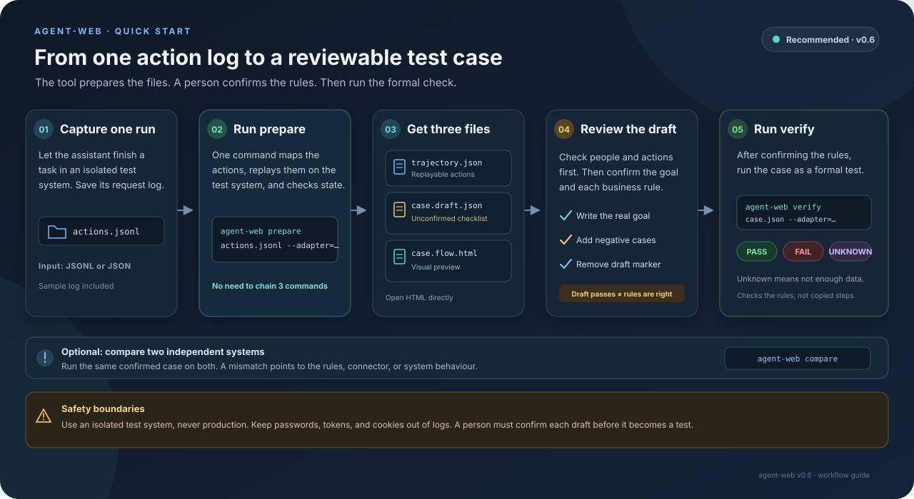

# agent-web

**Check whether an AI assistant really finished the job.**

[中文](README.md) · **English**

AI assistants can place orders, handle support tickets, and update inventory. The hard part is knowing whether they actually did it right.

agent-web works like a quality inspector with a checklist: decide what a correct result looks like, let the assistant do the work, then check what really happened. It does not judge by tone, gut feeling, or another model's score.

**In one line: give different systems the same test, use the same rules, and compare their results.**

---

## What this project actually governs

Most evaluation tools build more tasks and more realistic environments. This project does something else: it makes **the verdict itself trustworthy**.

All four pieces are needed. Drop one and an all-green verdict goes back to meaning nothing:

| Mechanism | What it stops |
| --- | --- |
| Three outcomes, `unknown` stays in the denominator | "I don't know" being quietly counted as a pass |
| An 18-row decision order, first match wins | The same case reporting different reasons on two implementations |
| Cross-implementation comparison (`compare`) | The thing being measured being swapped out while every step stays legal |
| False-green audit (`audit`) | A judge that under-reports its own misses |

It also has to admit when it gets fooled. `docs/museum` collects six false passes, each of which can be run to show what happens without the mechanism that catches it — including a real incident: an adapter silently swapped "another customer" for the person who placed the order, so the case passed stably while never once testing what it claimed to test.

```
docs/museum/README.md
```

---

## Three possible results

| Result | Plain meaning | Example |
| --- | --- | --- |
| `pass` | Passed | The order was placed and picked up by the right person |
| `fail` | Did not pass | The assistant says an order is ready, but it is not |
| `unknown` | Not enough information to decide | The system does not expose the needed data, or the test connection failed |

“I don't know” is not the same as “wrong” or “right”. So `unknown` is counted separately, never quietly counted as a pass:

```text
decidable rate = (pass + fail) / all cases
unknown rate   = unknown / all cases
```

That way, missing information cannot make the score look greener than it is.

---

## A cup of coffee explains it

The task: a customer places an order, a staff member accepts and prepares it, and **the same customer** picks it up.

A checklist might say:

1. The number of orders increases by one.
2. The final order status is “picked up”.
3. The order goes through “making → ready → picked up”.
4. A different customer must not be able to pick it up.

The assistant may take different steps from the sample route. It passes if the final result meets the rules. A familiar-looking route with the wrong result does not pass.

---

## Try it in 3 minutes

You need Node.js 20 or later. No extra packages are required.

```bash
git clone https://github.com/liuzheng6621/agent-web.git
cd agent-web

# Run built-in examples. No external service needed.
node bin/agent-web.mjs selftest

# Check one specific case
node bin/agent-web.mjs verify cases/coffee/happy-path.json --adapter=memory
```

`selftest` runs seven examples: normal completion, unauthorized pickup, a missing step, and cases with insufficient information. Passing these examples means the basic checking flow works; it does not mean every real system has been tested.

---

## User guide: from action log to a formal verdict



Already have a request log from one run of the assistant? The short path is: log → `prepare` → human review → `verify`. `prepare` creates replayable steps, a draft checklist for review, and a flow-chart preview:

```bash
node bin/agent-web.mjs prepare examples/agent-traces/memory-happy-path.jsonl \
  --adapter=memory \
  --id=coffee/happy-path \
  --goal="The customer places an order and picks it up" \
  --out-dir=agent-web-output/coffee-happy-path
```

You will get:

```text
agent-web-output/coffee-happy-path/
├── trajectory.json     actions rebuilt from the log
├── case.draft.json     a checklist based on what happened
└── case.flow.html      an offline flow-chart preview
```

Review them in this order:

1. Open `case.flow.html`. Check that each person and action is shown correctly.
2. Review the goal, checks, and “to confirm” notes in `case.draft.json`. The draft describes what happened in this run; **passing its own check does not mean its rules are correct**.
3. Add the real business goal and negative cases (for example, another customer must not pick up the order). Then run `verify`.

`prepare` replays the write actions against the adapter you specify, so point it only at an isolated test system, **never production**. If it finds fields that look like passwords, tokens, or cookies, it stops without writing output. It also refuses to overwrite existing output files.

The demo log uses a simple format: operation name, role, outcome, and arguments. It needs no network address. Real HTTP logs are supported too, but the adapter must first map request URLs to operations and translate request arguments. For your own service, replace `--adapter=memory` with your connector and use a dedicated test environment.

After reviewing the draft, add the real goal and any required negative cases. When a person has confirmed it, remove the trailing `draft` note from the case JSON and run:

```bash
node bin/agent-web.mjs verify agent-web-output/coffee-happy-path/case.draft.json --adapter=memory
```

This checks that the case is valid and runnable. A successful run does not prove that the business checklist is complete; a person must confirm that.

---

## Check what the assistant actually did

The steps stored with a case are a sample route, not necessarily the route the assistant took. To check the assistant's own actions:

```bash
node bin/agent-web.mjs verify cases/coffee \
  --adapter=memory \
  --trajectory=examples/candidate-trajectories \
  --out=candidate-results.jsonl
```

`--trajectory` points to files containing the assistant's actions. `--out` saves the results for each case. The repository includes two sample routes: one stops after placing an order; the other takes an extra step and reaches the goal.

**The check is about the result, not copying the sample actions.** The sample route may miss the goal while the assistant takes a different route and succeeds.

The two demo routes intentionally produce different results from the reference answers. `verify` can therefore exit with code 1 and mark the differences; that is the demonstration, not a broken command.

---

## Advanced: run the prepare stages separately

Use `prepare` for the normal workflow. Run `record`, `draft`, and `flow` separately when you want to inspect an intermediate file or replace one stage:

```bash
# 1. Request log → replayable steps
node bin/agent-web.mjs record examples/agent-traces/memory-happy-path.jsonl \
  --adapter=memory \
  --out=agent-web-output/coffee/trajectory.json

# 2. Replayable steps → draft checklist
node bin/agent-web.mjs draft agent-web-output/coffee/trajectory.json \
  --adapter=memory \
  --id=coffee/happy-path \
  --goal="The customer places an order and picks it up" \
  --out=agent-web-output/coffee/case.draft.json

# 3. Draft case → flow-chart preview
node bin/agent-web.mjs flow agent-web-output/coffee/case.draft.json \
  --out=agent-web-output/coffee/case.flow.html
```

After confirming the checklist, remove the trailing `draft` note from the case JSON and run the formal check:

```bash
node bin/agent-web.mjs verify agent-web-output/coffee/case.draft.json \
  --adapter=memory --out=agent-web-output/coffee/results.jsonl

# Refresh the flow chart with the formal verdict and observed events
node bin/agent-web.mjs flow agent-web-output/coffee/case.draft.json \
  --result=agent-web-output/coffee/results.jsonl \
  --out=agent-web-output/coffee/case.flow.html
```

If checking a candidate route (the actions the assistant actually took), `--result` must come from that same candidate route. Do not attach the verdict for the reference route to candidate steps. See [checking an assistant's route](#check-what-the-assistant-actually-did) for the full command.

These commands can also handle real HTTP logs. `record` needs the adapter to map request URLs to operations and convert request arguments. Each log entry needs the actor, request method, and URL; include request content and response when possible. Never log passwords or tokens. Later steps refer to IDs returned by earlier ones. Unrecognized requests are listed with reasons instead of guessed.

The flow chart is a standalone HTML file. Double-click it to open. It shows steps, roles, expected and actual outcomes, status changes, and check results. It supports filtering, expandable arguments, keyboard operation, and light/dark themes. Sensitive inputs are redacted; the page only displays saved data and does not re-run actions.

**A passing draft self-check does not prove the rules are right.** The checklist is inferred from what happened in that sample run, so a replay passing is expected. Before using it as a formal test, have a person confirm the goal, checks, negative cases, and permission boundaries.

---

## Give two systems the same test

agent-web includes an in-memory demo system and can connect to a sample coffee-shop service. Run the same cases against both:

```bash
# Start the sample coffee-shop service on localhost port 8080 first
TAIXIANGLIAN_BASE_URL=http://127.0.0.1:8080 \
  node bin/agent-web.mjs compare cases/coffee \
  --adapters=memory,taixianglian
```

Example output:

```text
case                          in-memory     coffee shop   same result
coffee/happy-path             pass          pass          ✓
coffee/foreign-pickup         fail          fail          ✓
coffee/unknown-capability     unknown       unknown       ✓

same result on 7 of 7 cases (100.0%)
```

Different answers do not immediately mean one system is broken. They tell you to check whether the rules are clear, whether the connection treated customer A and customer B as different people, or whether the systems really behave differently.

This comparison once caught a real problem: the case said “customer B picks up the order”, but the result said pass. The coffee shop had not handed over the wrong drink. The connector had treated customers A and B as the same person, so it actually ran “A picks up A's order”. The test checked the wrong person but still looked perfectly green. Comparing it with an independent implementation exposed the mismatch. Full story: [incident report](docs/FINDING-001.en.md).

---

## Use the real backend as a ruler: false-green audit

"Two verdicts agree" is an observation, not proof. A real ruler has to be another implementation: a case the real backend judges `fail` must also be judged `fail` by the new one.

```bash
# 1. archive both runs
TAIXIANGLIAN_BASE_URL=http://127.0.0.1:8080   node bin/agent-web.mjs verify cases/coffee --adapter=taixianglian --out=real.jsonl
node bin/agent-web.mjs verify cases/coffee --adapter=memory --out=memory.jsonl

# 2. audit one verdict set against the other served as oracle
node bin/agent-web.mjs audit real.jsonl memory.jsonl --detail
```

The output is a confusion matrix:

| Cell | Meaning | Risk |
| --- | --- | --- |
| agree·pass | both say it is fine | — |
| agree·fail | both say it is broken | — |
| **false green** | it is broken, the candidate says fine | worst: it stays green forever |
| false red | it is fine, the candidate says broken | noisy, not dangerous |
| blind | the oracle decides, the candidate cannot | insufficient evidence |

One false green makes `audit` exit 1. This is not a style preference: a false red sends someone to look, a blind spot is honestly recorded as `unknown`, and only a false green makes an unusable verdict look perfect.

## A draft must pass a human first

`draft` derives a case from a real trajectory and marks it `draft.status: "unconfirmed"`. **Such a case produces no verdict** — it is recorded as `unknown / unconfirmed_draft`. A machine-written exam cannot grade anything until somebody has read it.

Confirm it once and it becomes an exam:

```bash
node bin/agent-web.mjs accept cases/coffee/my-draft.json --by=YG
# 已确认 cases/coffee/my-draft.json
#   draft.status: unconfirmed → confirmed
#   reviewed_by:  YG
#   reviewed_at:  2026-11-04T07:41:16.195Z
```

Anonymous confirmation is rejected (`--by` is required): "somebody looked at it" that cannot be named is the same as nobody looking. Hand-written cases carry no `draft` field and are unaffected.

## Health report: how many of these verdicts came from a blind spot

`audit` needs a second implementation before it can say anything. `traps` does not: given the results plus the case files, it asks one question per verdict — was this verdict produced in a blind spot?

A blind spot means the verdict looks conclusive, but the risk cannot be ruled out from the verdict itself. "The result is right but the process was not", or "someone else executed the step" — both produce a stable `pass`, and neither makes the judge complain.

```bash
agent-web verify cases/coffee --adapter=memory --out=r.jsonl
agent-web traps r.jsonl --cases=cases/coffee --detail
```

```
陷阱普查（7 条判决）

  陷阱              涉及   有据可查   盲区   盲区率
  身份塌缩                5          5      0   0.0%
  事件词表缺失              0          0      0   —（分母为 0）
  草稿闸门                0          0      0   —（分母为 0）
  只看终态                5          0      5   100.0%

  盲区风险点：5/10   盲区率 50.0%
```

The report is meant to look bad. Ours says five cases only assert the final state: **process games that land on the right end state are invisible to those five verdicts.**

Four states, and they must not be conflated:

| State | Meaning |
|---|---|
| not applicable | the case cannot hit this trap structurally |
| guarded | it does, and the verdict carries checkable evidence |
| blind | it does, and the verdict still looks conclusive |
| unusable | the verdict itself is void (environment failure) |

"Guarded" only means the verdict carries evidence. It does not mean safe — an adapter can lie. Same stance as the rest of this document: we only record what we can see.

It reports by default and does not gate. Pass `--max-blind=0.2` to make it fail the build above a threshold. There is no default threshold because the blind rate is structural — "terminal state only" is often wrong for a whole batch — and a default would turn CI permanently red, get switched off by one flag, and never be looked at again.

## Why an assertion earns its place: certification

An assertion whose removal leaves the verdict unchanged is not a criterion, it is a comment.

You cannot see "is it useful" by reading it. So ask a different question: **can it catch the bug?**
Copy the correct implementation into several bodies that are broken in exactly one way — money off by
a cent, status frozen at PENDING, the event log emptied, a foreign order appearing in the list, a
cross-tenant write let through, a transition that should have been refused — then ask each assertion:

> True on the correct implementation, false on this body?

Two kinds of "true" do not count: still true on the body (it cannot see that bug), or turned
*unknown* (it has nothing to say). The second is this project's three-valued discipline applied to
itself: `unknown` is not "roughly right", and it cannot earn an assertion any credit.

This repository's own account:

```
agent-web certify cases/coffee --adapter=memory --detail
```

| Body | Layer | What catches it |
| --- | --- | --- |
| `m-money-off-by-cent` | observation | `happy-path#goal[4]` (amount 28) |
| `m-status-frozen` | observation | `cancel-before-pickup#goal[0]`, `happy-path#goal[1]`, and one more |
| `m-history-empty` | observation | `happy-path#inv[1]` (four log entries) |
| `m-extra-foreign-order` | observation | `happy-path#goal[3]` (order count +1) |
| `m-foreign-write-allowed` | execution | verdict level — a negative step that stopped refusing |
| `m-no-reject` | execution | verdict level — same |

**The first run looked bad, and that bad result is the feature.** With 13 assertions and 6 bodies:
10 could be evaluated, only 5 caught anything, and **four bodies walked through untouched** —
nothing asserted about money, "there must be no `order.canceled` event" came out vacuously true
on an emptied log, and the two execution-level bodies are only visible to negative steps that the
cases did not have. After adding two assertions (amount = 28, four log entries), all six bodies are
caught, 7 of 12 evaluable assertions are useful, and the **minimal set covering every
assertion-caught body is 4**.

That last number is the one worth repeating: of 12 assertions, 4 do the work. The other 8 are this
repository writing notes to itself.

Boundaries worth knowing:

- **Exit code** is 1 when any body survives. `--strict` also fails when an assertion eats a slot and
  catches nothing (off by default: being temporarily useless is a normal intermediate state, and a
  blunt gate makes people switch the whole command off).
- `unknown` on a body is not a kill. It only means the criterion had nothing to say.
- `audit` needs two implementations to know true from false. `certify` needs one correct
  implementation plus a set of ways to be wrong — no second implementation at all.
- It does not prove the cases are right. Bodies only cover the bugs you thought of; the list of
  bodies is itself something to review, which is why it lives in the repository and not inside CI.

### The list of bodies is open for contribution

The six bodies live in `docs/mutants/`, one file each, carrying `symptom` (what the user complains
about), `mechanism` (what was changed) and `catch_hint` (which assertion can see it, and which
cannot). List them all: `agent-web mutants`.

The four acceptance rules are in [docs/mutants/README.md](docs/mutants/README.md): it maps to a real
failure, you can name what catches it, it is not a duplicate of the existing six, and the places it
cannot be caught are admitted.

**This list is the one thing other people can contribute.** Cases must fit a specific system and the
spec has to stay stable, but "here is another way a system can be wrong" is something everyone can
speak about.

### Swap the implementation; the admission verdict should not move a single field

Same cases, `--adapter` switched from the built-in implementation to a real backend (a Spring Boot
coffee shop on port 8180). The two reports agree **field by field**: the same seven verdicts, the
same six bodies caught, 12 evaluable assertions with 7 useful, and the same four assertions in the
minimal set.

That is stronger than "100% verdict agreement": it says *which assertions do the work* does not
depend on the implementation either.

One real lesson from doing it: the log assertion was first written as "four log entries" — true on
the built-in implementation (which also records order creation), false on the real backend (which
records only transitions, three entries). Rewritten as "exactly one `order.picked` event", it holds
on both. **Assert event types, not totals** — totals are the implementation's freedom, event types
are the business fact.

## One copy of the cases

`cases/coffee/` is not duplicated per implementation. The same directory hits different systems by switching `--adapter`:

```bash
node bin/agent-web.mjs verify cases/coffee --adapter=memory
node bin/agent-web.mjs verify cases/coffee --adapter=taixianglian
```

A case describes "what a coffee ordering system should do", independent of who implements it. Copying it per implementation gives you two truths that slowly diverge — FINDING-001 started exactly there: two copies treated as one comparison.

---

## Check whether the system changed

The system may have different starting data after an update. Save the results from before and after, then compare them:

```bash
node bin/agent-web.mjs verify cases/coffee --adapter=memory --out=before.jsonl
# After the update, run it again and save the results as after.jsonl
node bin/agent-web.mjs verify cases/coffee --adapter=memory --out=after.jsonl
node bin/agent-web.mjs drift before.jsonl after.jsonl
```

`drift` checks whether the data visible at the start of a test changed. If it did, review whether the case still fits the new version. This does not mean the verdict itself was wrong.

---

## Connect your own system

Point `--adapter` at a small connector program:

```bash
node bin/agent-web.mjs verify my-cases --adapter=./my-adapter.mjs
```

`examples/adapter-template/` contains a working sample. The connector has five jobs:

| Method | What it does |
| --- | --- |
| `manifest()` | Lists the operations and data the tool can use |
| `reset()` | Prepares fresh test data |
| `observe()` | Reads the current orders, inventory, and other state |
| `execute()` | Performs one operation in the system |
| `close()` | Ends and cleans up the test run |

See the [working connector example](examples/adapter-template/README.md) and [case format](docs/SPEC.md) for the details.

---

## How much of the system do these cases actually touch

A verdict answers "how did these cases go", not "have these cases covered the system". `coverage` reconciles what the manifest declares with what the cases actually use:

```bash
node bin/agent-web.mjs coverage cases/coffee --adapter=memory --detail
```

```text
一、能力对账
  声明能力        9
  被案例用到      6
  从未被用到      3   ← not a bug, just cases that have not reached it yet
  案例要但没声明  1   ← a real gap: those steps can only ever be unknown
  覆盖率          66.7%   = used / declared
```

Keep the two apart: **unused** means the cases are not demanding enough, **missing** means a verdict can never get evidence. The bundled `unknown-capability` case is a deliberate gap (it is what demonstrates `coverage_gap`), so running against `cases/coffee` always reports one missing capability and exits 1 — that is not dirty data.

`--min=0.8` turns it into a gate: no gaps and the rate must clear the bar. Observation scopes get their own line — if a case reads a collection the manifest never declares, those assertions can only be `unknown`.

## An adapter is executable code

`--adapter=./xxx.mjs` does not read a config file; it imports that file as a plain Node module. It runs on your machine, as you: it can read environment variables (tokens included), touch the filesystem, and make network calls.

So:

- Only load adapters you trust, especially ones shipped inside a case set somebody gave you
- Read the file once before the first run. It is a few hundred lines; `fetch` and `fs` are easy to spot
- agent-web prints a warning before loading an external adapter; set `AGENT_WEB_QUIET_ADAPTER_WARNING=1` once you have acknowledged it

The built-in `memory` and `taixianglian` adapters load internally and never trigger that warning.

## A short glossary

The code keeps fixed English names. Here is what they mean in everyday terms:

| Code term | Plain meaning |
| --- | --- |
| Case | A test question: the goal, checklist, and sample route |
| Trajectory | The sequence of actions the assistant took |
| Adapter | A small connector between the test tool and a real system |
| Assertion | A clear rule that can be checked as right or wrong |
| `unknown` | There is not enough information to score this run |
| Reset | Prepare fresh data so an earlier test cannot affect the next one |

---

## What it can check

| Check | Plain meaning |
| --- | --- |
| `entity_exists` | Does a requested record exist? |
| `field_equals` | Does a field contain the expected value? |
| `count_delta` | How many records were added or removed? |
| `unchanged` | Did specified data stay the same? |
| `status_transition` | Did the status go through the required changes? |
| `event_absent` | Did a forbidden event happen at any point? |
| `composite` | Combine checks with “and”, “or”, or “not” |

It checks concrete facts such as order status, record counts, and recorded events. It does not judge whether a page looks nice, prose sounds elegant, or something “feels right”. If there is no clear rule, it will not pretend that a machine can score it.

---

## Current limits

- Each real system needs a connector written by a person; giving the tool a URL is not enough yet.
- Data names must be lined up by the connector. The tool does not automatically know that `orders` in one system means the same thing as `tickets` in another.
- It mainly checks the final result and recorded events. It cannot yet measure process quality such as “the assistant clicked three times before getting it right”.
- Cases run in order; running them across multiple machines at once is not supported yet.
- A draft can list what happened. A person still has to add rules for forbidden actions, permissions, and time limits.

---

## Project files

```text
bin/agent-web.mjs       Command-line entry point
src/                   Checking, cases, logs, drafts, and flow-chart code
cases/                 Built-in test cases
examples/              Working connectors and sample action logs
  agent-traces/memory-happy-path.jsonl   simple log for trying prepare
docs/SPEC.md            Detailed case-file format
test/engine.test.mjs    Automated tests (49 cases)
```

Common commands: `prepare` (create steps, a draft case, and a flow preview in one run), `selftest` (run the built-in checks), `verify` (check cases), `compare` (compare systems), `record` (organize request logs), `draft` (make a case draft separately), `flow` (make a flow chart), and `drift` (compare whether the starting data changed). Run `node bin/agent-web.mjs help` for the full list.

---

## Pushing to the GitHub mirror

The repo lives on both Gitee and GitHub. On a machine whose `hosts` file points `github.com` at `127.0.0.1` (symptom: `curl https://github.com` returns `000` while `dns` and `conn` take a few milliseconds and `tls` is `0`), `git push github` dies in the TLS handshake. Editing `hosts` needs admin rights and may be overwritten by whatever script wrote those lines.

`scripts/gh-proxy.mjs` routes around it: resolve the name once through DNS (bypassing `hosts`), then relay the tunnel byte for byte. TLS is still negotiated end to end between git and GitHub with the same SNI, so certificate validation stays on and nothing gets disabled.

```bash
node scripts/gh-proxy.mjs &                                     # 127.0.0.1:8899
git -c http.proxy=http://127.0.0.1:8899 push github main
# or set it for this remote only, and delete the config once the proxy is gone
git config --local http.https://github.com.proxy http://127.0.0.1:8899
```

Addresses are tried in order (DNS results plus a small fallback list); GitHub's IPs come and go, so `node scripts/gh-proxy.mjs --ip=140.82.114.4` pins one when needed. It binds to loopback only; shut it down when you are done. **This is not a feature for users** — it is a maintainer's temporary channel on this particular machine.

---

## Version and next steps

Current version: `0.9`. It runs cases, checks an assistant's actions, turns a request log into replayable steps and a draft case, polices the verdict itself (one copy of the cases, no verdict from an unreviewed draft, a false-green audit that turns a suspiciously all-green verdict red), and measures how much of the system the case set actually touches.

Next: make it easier for different systems to share the same cases, run tests against multiple systems at once, and turn abilities that are only inferred into abilities that have been verified in practice.

MIT license. See [LICENSE](LICENSE).
