# agent-web v0.54.1

<p align="center">
  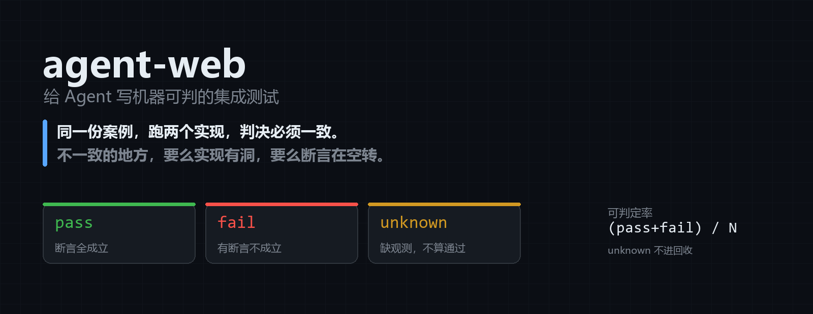
</p>

<h3 align="center">给 Agent 写的集成测试</h3>

<p align="center">
  一份案例，跑两个实现，判决必须一致。不一致的地方，要么实现有洞，要么断言在空转。
</p>

<p align="center">
  
  
  
</p>

<p align="center">
  <b>当前版本 0.54.1</b> · 19 种断言 · 31 条命令 · 56 个变异体
</p>

<p align="center">
  这一行是算出来的：版本取自 <code>package.json</code>，断言种类取自 <code>KINDS</code>，
  命令数与变异体数取自代码本身。<code>scripts/status-line.mjs</code> 对不上就红，CI 在跑。
</p>

---

## 六十秒上手

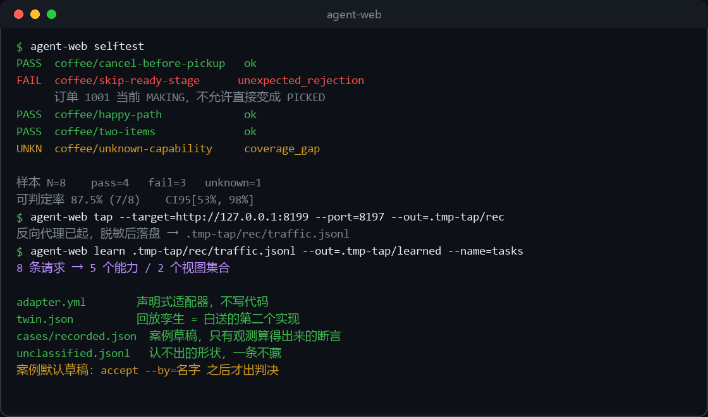

第一条命令不需要任何准备：

```bash
git clone https://gitee.com/liu-everything_impossble/agent-web.git
cd agent-web
node bin/agent-web.mjs selftest
```

`selftest` 用内置内存实现跑内置案例：pass、fail、unknown 三种判决各出现一次。
fail 的那条会直接告诉你「订单 1001 当前 MAKING，不允许直接变成 PICKED」——不是「测试失败」四个字。

手上已经有一个能跑的系统？看你想省哪一步：

```bash
./quickstart.sh http://127.0.0.1:8080        # Windows: .\quickstart.ps1 那个地址
#   只读接口 → 直接生成能跑的适配器 + 案例草稿 + NEXT.md 施工单
#   有流量可录 → 用 tap + learn，适配器、孪生、案例一起掉出来（见下两节）
```

`quickstart.sh` 就是 `discover` 加三条「接下来做什么」的提示；它不猜业务规则，
猜不出来的会写在 `NEXT.md` 里，而不是悄悄编一条。

想看它动起来：

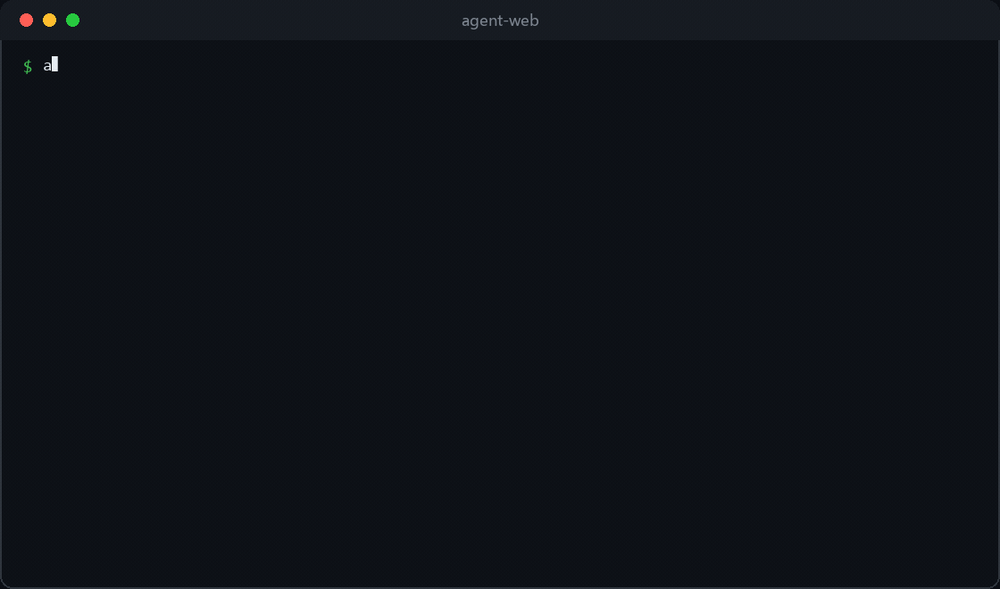

52 秒介绍片（判决三种、输入网址、录流量、断言准入、出题批改）：[docs/media/promo.mp4](docs/media/promo.mp4)

## 它解决的问题

Agent 改代码改得很快，但「改对了没有」经常只能靠人肉点一遍。单元测试管不到跨请求的状态流转，端到端测试又慢、还不稳。

agent-web 的做法：把一次真实业务操作写成**案例**（做什么 + 结果该是什么），然后拿它同时打两个实现——一个内置的内存实现，一个你真实的系统。两边判决必须一致。

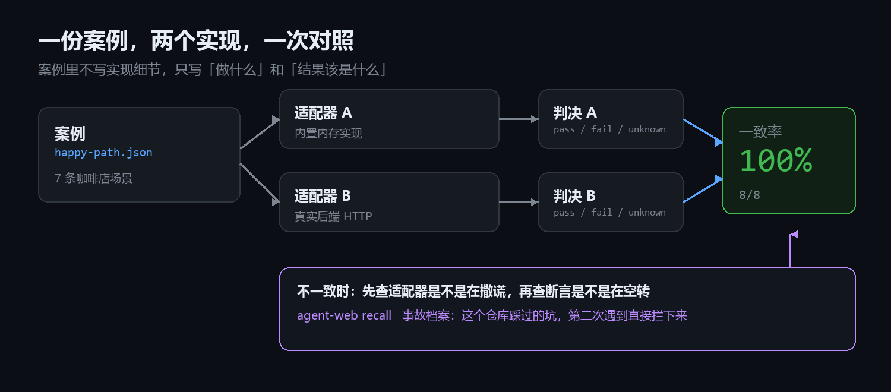

一致，说明案例可移植、断言没写死实现细节。不一致，就有一处要修，而且你能立刻知道是哪一处。

## 判决只有三种

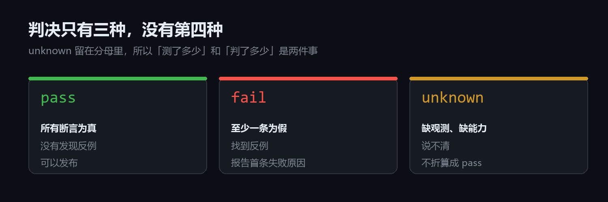

- **pass**：所有断言成立。
- **fail**：有断言不成立，并指出哪一条、期望什么、实际什么。
- **unknown**：缺观测、环境故障、案例还没人确认。**留在分母里，不算通过。**

可判定率 = (pass + fail) / N。unknown 不回收，所以这个数字只会因为观测被修好而上升，不会因为掩盖而上升。

## 输入一个网址

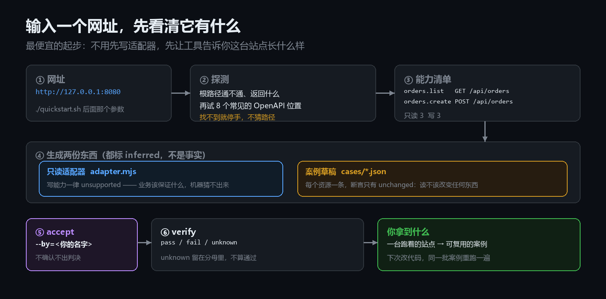

没有适配器也能起步。`discover <网址>` 探根路径、试 8 个常见 OpenAPI 位置，然后：

- 只读接口 → 一个能跑的只读适配器（写能力一律 `unsupported`）
- 每个资源 → 一条案例草稿，断言只有 `unchanged`：读不该改变任何东西
- create 接口（`--writes`）→ 往返案例：建一条，断言 `count_delta +1`
- 一份 `NEXT.md` 施工单：要接写操作，改哪四处、每步怎么验收

它不猜三件事：写操作该保证什么、带参数接口的路径、没有 OpenAPI 时的路由。
猜出来的 404 会变成假失败，而假失败会让工具失去信任。

## 录一段流量，长出一个适配器

写适配器是这套东西最贵的一步。这一节讲怎么把它压到十分钟。

```
agent-web tap --target=http://127.0.0.1:8199 --port=8197 --out=.tmp-tap/rec
# 另开一个终端，正常点几下：登录、建三条任务、完成一条、看列表
agent-web learn .tmp-tap/rec/traffic.jsonl --out=.tmp-tap/learned --name=tasks
```

四样东西一起掉出来：

| 产物 | 是什么 |
|---|---|
| `adapter.yml` | 声明式适配器，不写代码 |
| `twin.json` | 回放孪生：这五分钟里应用答应过什么 |
| `cases/*.json` | 案例草稿，断言只有从观测直接算得出来的 |
| `unclassified.jsonl` | 认不出的形状，一条不藏 |

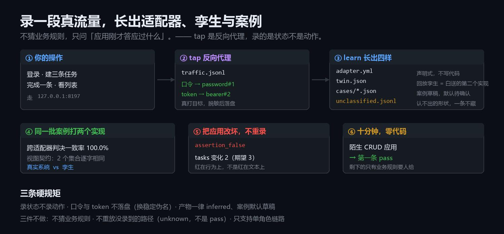

`twin.json` 是白送的第二个实现。同一批案例同时打真实系统与孪生：

```
agent-web compare .tmp-tap/learned/cases --adapters=.tmp-tap/learned/adapter.yml,.tmp-tap/learned/twin.json
```

```
跨适配器判决一致率 100.0% (1/1)

视图契约
  learned/adapter.yml 与 learned/twin.json：兼容（2 个集合逐字相同）
```

然后是最要紧的一步——**把应用改坏，不重录**：

```
TODO_APP_BUG=1 node examples/todo-app/server.mjs &
agent-web verify .tmp-tap/learned/cases --adapter=.tmp-tap/learned/adapter.yml
```

```
FAIL todo/recorded   assertion_false
     目标未达成：tasks 变化 2（期望 3）
```

这条红说明案例抓的是**应用的行为**，不是录制的文本。如果 tap 只是把响应存下来，改坏的应用会照样绿。

三条硬规矩：

- **录状态，不录动作。** 同类工具录动作得到一份脚本，我们录状态得到孪生与判决。
- **口令与 token 不落盘。** 换成 `password#1` 这种稳定伪名，同一个值始终同一个名字。正文里用户自己填的敏感内容不在脱敏范围内，录制文件仍然是内部资料。
- **生成的每一样都标 `inferred`，案例默认草稿。** 不 `accept` 就不出判决——机器观测不许冒充成人的期望。

做不到的三件：不猜业务规则（录到下架成功不等于知道「库存不足该拒绝」）；不重放没录到的路径（`unknown`，不是 `pass`）；只支持单角色链路（录到管理员才做得成的删除，回放会 403）。

## 断言能说的，比「第 0 行等于 56」多

17 种 kind，全部机器可判，没有一种是「让模型看看对不对」：

| kind | 说什么 |
|---|---|
| `entity_exists` / `field_equals` | 某行存在 / 某字段等于某值 |
| `count_delta` | 某集合数量变化了多少 |
| `status_transition` | 状态按给定序列走过 |
| `unchanged` | 某段观测初态到终态没变 |
| `event_absent` | 某类事件一次都没发生 |
| `relation` | 字段之间的关系：合计等于明细之和、单价乘数量等于小计、列表有序 |
| `sorted_by` / `unique` / `type_of` / `subset` | 形状：有序、不重、类型对、取值在集合内 |
| `composite` | 与 / 或 / 非 |
| `window` / `every_step` | 圈定步骤区间 / 每一步都检查不变量 |
| `pagination` | 跨页检查重复、漏行、顺序与 total |
| `payload` | 检查某一步的 HTTP 响应体 |
| `linkage` | 检查跨集合实体关联与对应数量 |
| `timeliness` | 终态 | 两个事件的真实时间戳之差不得超过上限（`max:"24h"`），必须声明 `timezone` |
| `state_machine` | trace | 只许走声明的那些边（`transitions`）；`walk:"rows"` 把流水集合当序列 |

关系式比写死具体值更耐移植：`totalAmount == Σ items.subTotal` 在哪个实现上都该成立，
而 `totalAmount == 56` 只在菜单价格不变时成立。形状断言同理——「列表不重」不依赖任何具体编号。

## 判据准入：一条断言要证明自己有用

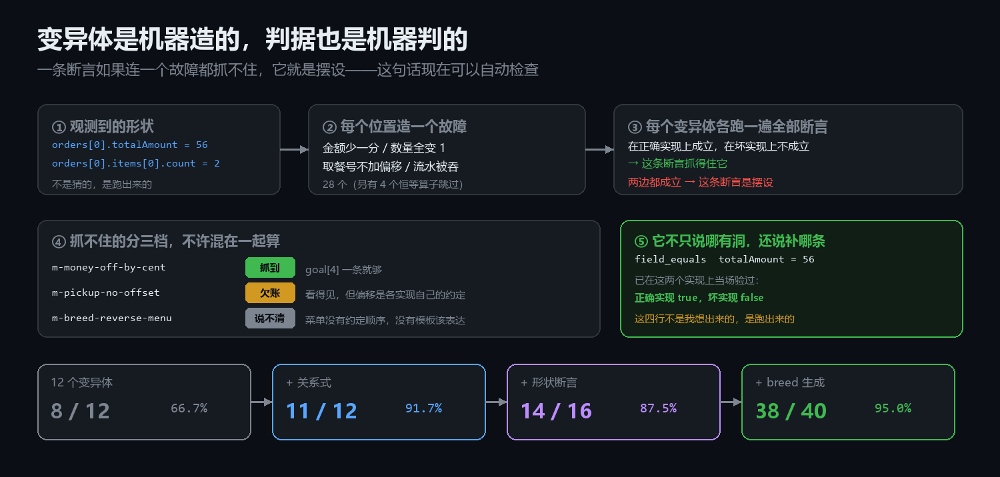

断言不是描述，是武器。**杀不掉任何变异体的断言不许入库。**

做法：把「能力」拆成一组语义变异（金额少一分、数量全变 1、流水被吞、越权写放行……），
让每条断言去杀它们。在正确实现上成立、在坏实现上不成立，才算抓得住；两边都成立，就是摆设。

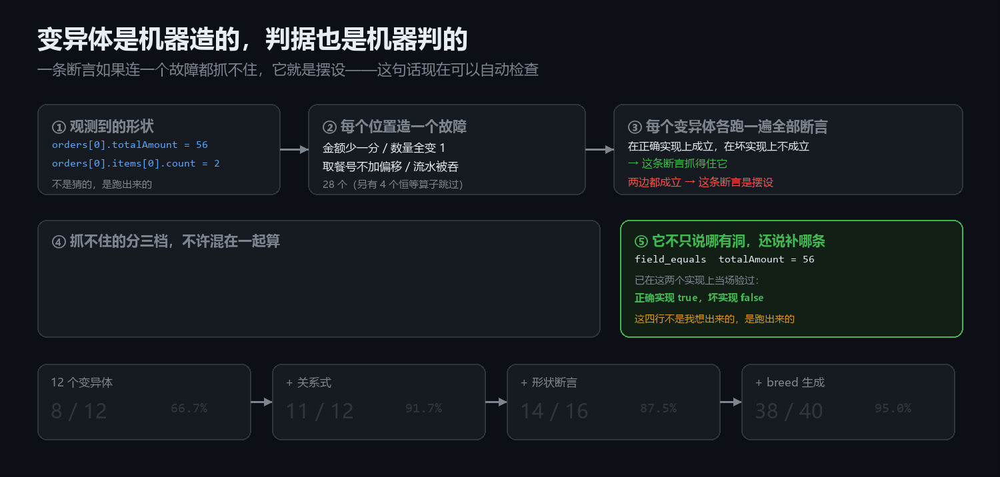

抓获率的演进，每一步都有对应机制上线：

| 阶段 | 抓到 | 靠什么 |
|---|---|---|
| 12 个手写变异体 | 8 / 12 | 基础断言 |
| + 关系式 | 11 / 12 | `relation` |
| + 形状断言 | 14 / 16 | `sorted_by` / `unique` / `type_of` / `subset` |
| + 机器生成 | 38 / 40 | `breed` 照着视图形状造变异体 |

抓不住的分三档，不许混在一起算：**欠账**（看得见差异，只差断言）、
**说不清**（连差异都造不出来，先确认案例走没走到）、**不适用**（该适配器没有它声明的能力）。
「说不清」不等于等价——等价变异体问题四十年没解决，这里只要求投稿人给出可区分性证明。

它不止说哪里有洞，还说补哪条：`--suggest` 给出的每条建议断言，都当场在两个实现上验过
（正确实现 true、坏实现 false）。这四行不是想出来的，是跑出来的。

### 跑两遍，不一样的地方不算故障

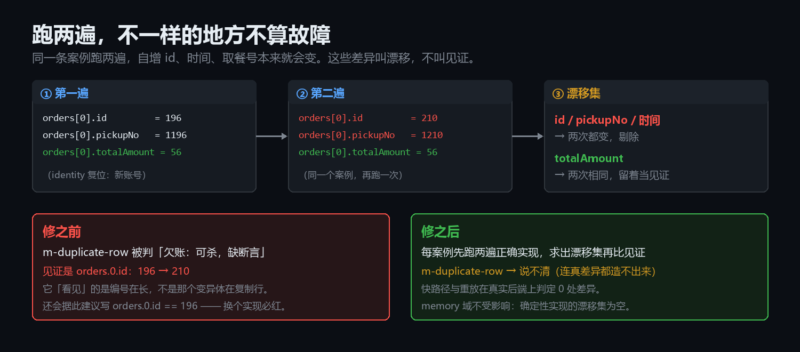

同一条案例跑两遍，自增 id、时间、取餐号本来就会变。此前这些差异被算成「变异体被看见了」，
真实后端上 `m-duplicate-row` 的见证是订单号从 196 长到 210，还会据此建议写 `orders.0.id == 196`。
现在每案例先跑两遍正确实现求出漂移集，再从见证里剔除。

顺带的优化：state 层变异体只改观测，certify 不再重放整条轨迹，直接用正确实现的 ctx 变换求值。
真实后端 3 条案例 44.5s → 15.1s（2.95×）。等价性由 `scripts/state-equivalence.mjs` 逐格证明并进 CI。

## 变异体不再只靠人想

`breed` 照着规范视图的形状造故障：数值字段差一 / 翻倍 / 丢分，字符串置空 / 大写，
数组丢尾 / 逆序，枚举换值，嵌套叶子逐个试。10 个可造位置出 29 个变异体，4 个恒等算子自动跳过。

**生成不等于入库**：每个都要过 certify，杀不掉的自动落「说不清」，不会污染抓获率。
变异体还能声明 `applies_to`——账本域的变异体在咖啡域就是「不适用」，不进分母。

## 分页：单看每一页都对，拼起来不对

翻页的四种坏法都藏在页与页之间：同一行出现在两页里、边界少一行、翻页顺序忽前忽后、
`total` 报的数字和实际条数不符。**单看任何一页都是好的**，逐页的 `count_delta` 也都是对的
—— 每页确实拿到了 `pageSize` 条。

```json
{ "kind": "pagination", "collection": "orders", "steps": [6, 7, 8],
  "total": 5, "pageSize": 2, "ordered_by": "id" }
```

它读的是那几步的**执行返回**（`trace[i].payload`），不是规范视图——视图是整份状态快照，
一条翻过页的列表在视图里和没翻过一模一样，拿视图判分页永远判不出来。

三个只在返回体上下手的变异体，视图完全不变，所以只有它能抓：

| 变异体 | 怎么坏 | 被抓时说什么 |
|---|---|---|
| `m-page-duplicate` | 第二页把上一页末行又带一遍 | 重复行：orders 的 id=1003 第 7 步的返回里出现了两次 |
| `m-page-drop` | 每页少给尾行 | 第 7 步不是最后一页，却只有 1 条（每页 2） |
| `m-page-shuffle` | 第一页内部倒序 | 翻页乱序：按页次拼接后 id 从 1002 掉到 1001 |

顺带修掉一个真 bug：`memory` 适配器的 `order.list` 原来在**规范视图**上按 `ownerId` 过滤，
而视图里只有 `username` —— 顾客的订单列表恒为空，只有店员看得见全部。之前没有案例用过
`order.list`，所以一直没露出来。

## 出题与批改：标签由机制产出，不由模型

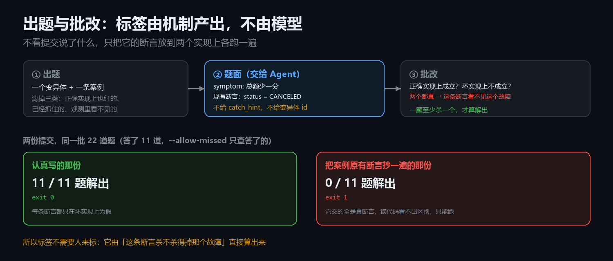

一个变异体加一条案例出一道题，题面只给症状和现有断言，**不给 `catch_hint`、不给变异体 id**。
批改不看提交说了什么，只把它的断言放到两个实现上各跑一遍：正确实现上成立、坏实现上不成立，才算解出。

同一批题两份提交：认真写的 11/11、exit 0；把案例原有断言抄一遍的那份 0/11、exit 1——
它交的全是真断言，读代码看不出区别，只能跑。这就是「标签不需要人来标」的意思。

为什么 good 只有 11 份答案，题却有 22 道：建议断言只能表达「集合内某个字段的取值差」，
整实体替换与集合外差异表达不了。剩下 11 道得人写答案。于是拆成两条校验：
默认「必须答满」（漏一题就 exit 1），`--allow-missed` 是「答了就必须对」（没答的照实报，
答错或交不上来的仍然失败）。CI 用后者——防瞎写和防偷懒是两件事，不能混成一件。

`drill grade --record` 把每次批改记进台账，`drill stats` 出统计。
台账只存题号、状态、每个断言的判定、提交指纹——不存提交内容。
所以 11/11 会显示成 `100.0% [74.1%, 100.0%]`，而不是「100% 稳了」；
每题至少 5 次批改才分层，不够就记 `insufficient_data`。
`drill --order=empirical` 按台账里的经验难度出题，难的在前。

## 判决长什么样：一个能打开的页面

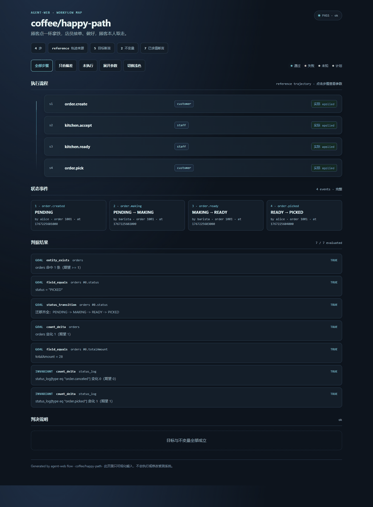

`flow` 把一条案例渲染成自包含 HTML：执行流程逐步可展开、状态事件、每条断言的三值结果、
被拒的步骤直接标红「期望 applied 实际 rejected」。点「只看偏差」只剩有问题的行。

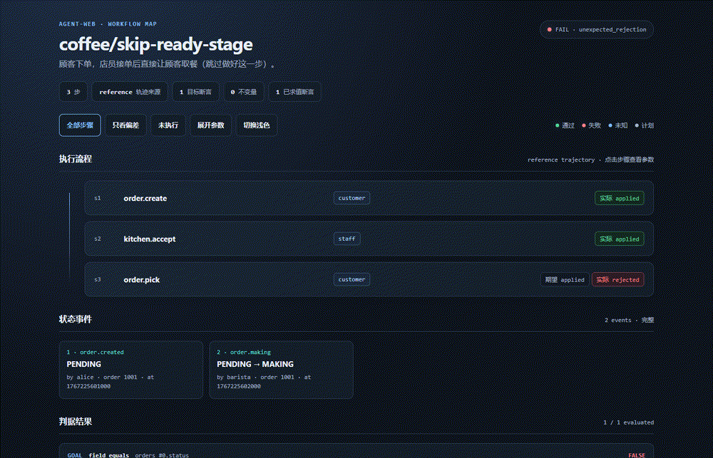

给一个目录，出总览页：判决分布、可判定率、带锚点的案例目录，点目录跳到对应案例。

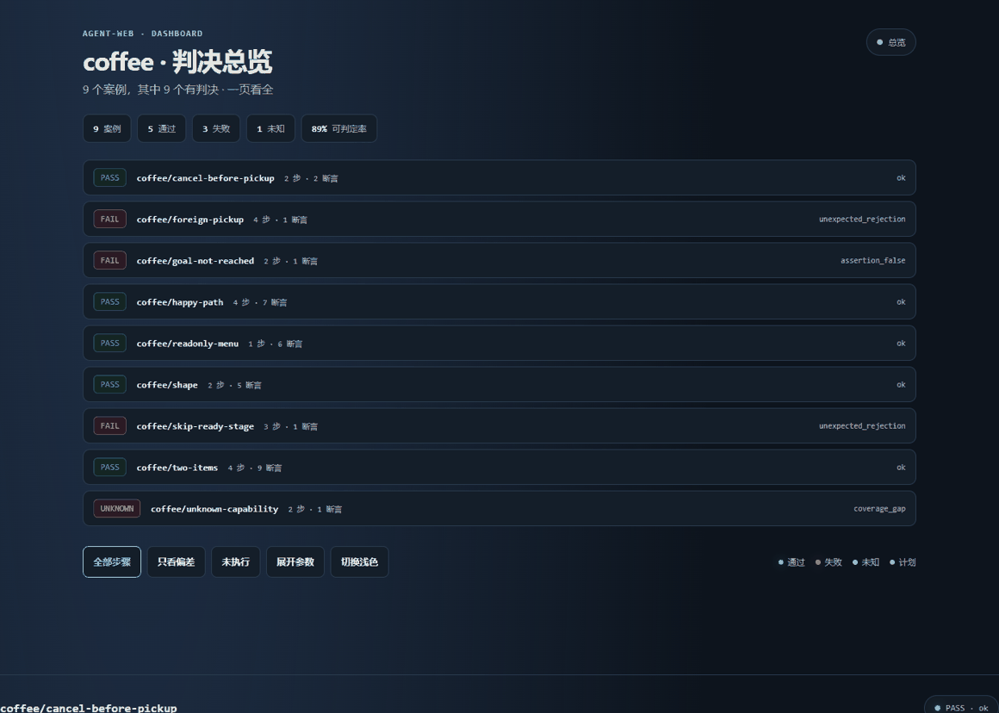

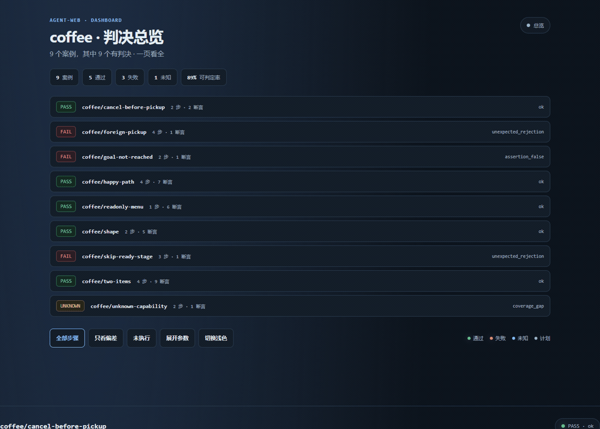

## 换个命名体系，字段还是那些字段

`learn` 学得出来的前提是「字段名认得」。别人的系统里 `totalAmount` 可能叫 `sum`、
`pickupNo` 叫 `no`、`orders` 叫 `tickets`。`align` 干的就是这件事——**给建议，不替你决定**。

```
$ agent-web align our-view.json their-view.json --out=align.yml
字段映射 · 3 个集合 · 17 / 17 条字段 → 100.0%

  orders → tickets   置信 95.0%
    createTime      → at              94.0%
    id              → key             94.0%
    items           → lines           94.0%
    pickupNo        → no              88.0%
    totalAmount     → sum             94.0%
```

五路信号，权重写死不调参：名字（复数归一到同义词组）、逐行取值一致、取值多重集一致
（行序不同也认）、枚举重合、基数一致。类型不同直接出局。

**低置信度一律不猜**：低于 0.75 进 `unresolved` 并给 top-3 候选。改名的夹具恢复 17/17、
零错配；把行打乱、`totalAmount` 改成 `x9`、`pickupNo` 删掉之后恢复 15/17，**仍然零错配**，
剩下两条如实写着「需要人签」。宁可说不清，也不许错配——一个错配的字段会让案例在
「看起来对、其实错」的地方判 pass。

## 事故档案：这个仓库踩过的坑，不许踩第二次

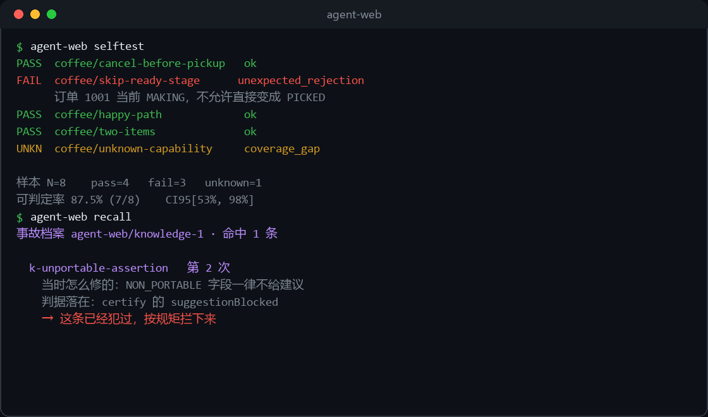

14 条档案，每条四要件：症状、根因、指纹（结构 / 见证 / 探测器）、**判据**（哪条命令或测试守着它）。
缺判据不收——没人守的档案只是回忆录。

`recall` 在跑批后比对指纹：第一次命中只提醒，**第二次犯同一条就 exit 1 拦下**。
加深记忆不是靠自觉，是靠退出码。

## 在四个域上验过（另有一个契约验证，不计入域数）

| 域 | 实现 | 它证明了什么 |
|---|---|---|
| 咖啡店点单 | 内置内存 + 真实 Spring Boot 后端 | 同一份案例打两个实现，判决一致率 100%；假通过能被抓出来 |
| 流浪动物追踪 `cases/animal` | Spring Boot 3 + MySQL 真实后端（第三方项目） | Spring Page 信封、大写状态、三角色；**审批接口没有角色检查**——案例判 fail，[细节](docs/domains/animal.md) |
| 复式记账 | 两个自造实现（整数分 vs 两位小数字符串） | 内部表示完全不同，视图逐字相同；借贷平衡这类不变式能表达 |
| 词库检索 `cases/lexicon` | 两个自造实现（字典树 + 贪心分词 / 二分 + 反向 DP） | 900 条数据、每页 10 条翻三页：跨页重复、边界丢行、`total` 说谎这三种坏法只有在这个规模上才真的暴露，[细节](docs/domains/lexicon.md) |

第三个域逼出了一个机制：变异体可以声明 `applies_to`。
账本域的变异体在咖啡域是「不适用」，不进分母——否则抓获率会被无关变异体砸成假坑。

第四个域（词库）补的是**数据规模**这一维：前三个域的分页断言都只在小结果集上跑过，
`total` 说谎、边界丢行这类坏法在小数据上看着全绿。
词库域还顺手补上了一个断言盲区——`pagination` 原先只数各页行数，
从不读实现自己报的 `total`，于是「30 条报成 900」在每一页都满的情况下全绿。

### 第五个目录 `cases/realworld`：契约验证，不计入域数

RealWorld（84k star，一份 OpenAPI 契约，990+ 个实现）的官方 13 个 hurl 套件已经转成了 13 条案例，
`verify cases/realworld --adapter=realworld` **13/13 pass**，并且进了 CI。

它**不计入上面那四个**，理由是一条门槛，不是谦虚：

> 域的门槛要求**两个独立实现**。`cases/realworld` 现在只有一个
> （`examples/realworld/fake-server.mjs`），没有第二个实现可对照，
> 而 `compare` 比的是「同一份案例在两个实现上判决是否一致」——
> 只有一份实现，这个域最核心的那件事就验不了。

它验的是另一件事：**转换器 + 适配器 + 夹具三者是否自洽**（hurl 的断言原样保留、不许手改）。
这有价值，但不是「跨实现一致性」，所以不往域数里凑。

补齐的办法写在 [docs/ROADMAP.md](docs/ROADMAP.md)：给同一份 `openapi.yml` 写第二个实现，
`compare --adapters=realworld,realworld-b` 一致率 100% 之后它才算第五个域。

## 命令一览

| 命令 | 干什么 |
|---|---|
| `selftest` | 零依赖自测，三种判决各来一次 |
| `verify` | 跑案例出判决 |
| `report` | 由判决结果出指标 |
| `accept` | 确认草稿；没确认的案例不出判决 |
| `capabilities` | 打印能力清单与证据等级 |
| `coverage` | 能力覆盖率对账，`--min` 设门槛 |
| `probe` | 探针：查适配器自己有没有在撒谎 |
| `certify` | 判据准入：变异体 × 断言杀伤矩阵，`--suggest` 给补法 |
| `breed` | 照着视图形状自动生成变异体 |
| `drill` / `drill grade` | 出题 / 批改，标签由机制产出 |
| `compare` | 同一份案例喂多个实现，比判决 |
| `drift` | 比较两次跑批的初态形状 |
| `record` / `prepare` / `draft` | 从真实动作日志还原轨迹、生成案例草稿 |
| `flow` | 单案例判决页；给目录出总览页 |
| `discover` | 探一个站点：只读适配器 + 案例草稿 + 施工单 |
| `crosscheck` | — | 不经过适配器自己的 fetch 再发一遍，比对响应：一致 / 不一致 / 查不了 |
| `import hurl` | 把 hurl 套件转成案例草稿（不联网、不执行） |
| `tap` / `learn` | 反向代理录一段流量，长出适配器 / 孪生 / 案例草稿 |
| `mutants` | 变异体目录：谁的坏法、怎么抓、怎么投稿 |
| `audit` | 假绿审计：拿真实后端当尺子量候选实现 |
| `traps` | 陷阱普查：这批判决有多少是盲的 |
| `knowledge` / `recall` | 事故档案 / 重犯检测（第二次 exit 1） |
| `init` | 生成案例模板 |
| `version` | 版本、最近变更、版本号三处是否一致 |

## 几个设计选择

- **没有 LLM judge。** 判不了就记 `unknown` 并留在分母里。引入打分模型等于把自己要解决的问题搬回来。
- **规范视图是契约。** 案例只写视图里的字段，不写实现细节；映射故意写在适配器里，可移植性靠 `compare` 验。
- **「谁来做」是案例的一部分。** 每一步带 `as`，适配器忽略角色会被 traps 指出来。
- **建议断言必须当场验过。** 正确实现 true、坏实现 false 才给出来；位置相关的建议会额外警告。
- **三档状态不混算。** 欠账、说不清、不适用各有各的出口；混在一起，基线表三天就没人看了。
- **两条校验不混用。** 「必须答满」防偷懒，「答了就必须对」防瞎写——合成一条就会互相放水。

## 现成的案例从哪来

自己写案例是最贵的一步。`import` 承认这件事，给了一个不靠猜的入口：**把别人已经写好的接口测试套件转成案例草稿**。

<div align="center">
  
</div>

RealWorld 是一组可复用的 API 契约语料：官方仓库附带 13 个 hurl 套件。导入器会保留路由动作、路径参数、角色和 token 捕获；不支持的断言会进入 `.todo.md`，不会静默丢弃。

<p align="center">
  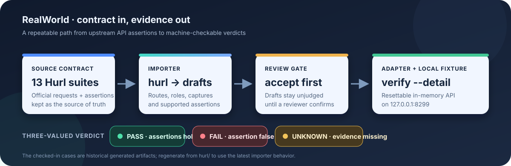
</p>

```bash
node examples/realworld/fake-server.mjs 8299 --allow-reset
node bin/agent-web.mjs import hurl examples/realworld/hurl --out=cases/realworld --as=user
# 先逐条检查生成的案例与 .todo.md，再 accept，最后运行：
node bin/agent-web.mjs verify cases/realworld --adapter=realworld --detail
```

过程预览：[终端动图](docs/media/demo.gif) · [52 秒介绍视频](docs/media/promo.mp4)

转出来的都是**未确认草稿**，`accept` 之后才能出判决。转换器只做能确定的事：

| hurl 里的东西 | 转成什么 |
|---|---|
| 请求 + JSON 体 | 一步，能力名按方法 + 资源推导 |
| `HTTP 201` / `HTTP 422` | 期望结果：`applied` / `rejected`；`5xx` 整块跳过 |
| `Authorization` 头 | 这一步用哪个角色（`--as` 指定） |
| `[Captures] slug: jsonpath "$.article.slug"` | 该步捕获，后续 `{{slug}}` 作为路径参数回填 |
| `[Asserts] jsonpath "$.tags" count >= 1` | `payload` 断言（读返回体，不读视图） |
| 读不懂的断言 | 写进同名 `.todo.md`，**一条不丢，一句不猜** |

**本地夹具已经内置**：`examples/realworld/fake-server.mjs` 提供零依赖的 19 端点实现，适配器位于 `src/adapter/realworld.mjs`。它便于验证导入器与判决链路；不能替代对真实 RealWorld 实现的兼容性测试。

状态口径要分清：`cases/realworld/*.json` 是 `import hurl` 的**派生文件**（断言逐条来自官方 hurl 原文，不许手改），当前实测 **13/13 pass**，并已进 CI。全绿只证明「转换器 + 适配器 + 夹具」自洽，不证明某个 RealWorld 实现是对的。

夹具只证明「转换器 + 适配器 + 判决链路是通的」，不证明「某个 RealWorld 实现是对的」——要验证真实实现，把 `REALWORLD_BASE_URL` 指向目标服务（详见 `examples/realworld/README.md`）。

<!-- limits:start -->
## 边界：已实现与仍未解决

这一节分两层。以下能力已经有代码和测试守着，不该再算成「没做」：

- `align` 能提出跨命名映射并附证据；低置信度留给人签。
- `window` / `every_step` / `pagination` / `linkage` 已覆盖时序区间、逐步状态、跨页和跨实体关系。
- `drill grade --record` / `drill stats` 已有台账、Wilson 95% 区间和经验排序；每题至少 5 次才分难度。
- `negatives` 按清单的声明派生负例候选（必填缺失、角色越权、类型不符、不存在实体、重复提交），全部标 `disputed`，只出审阅表。

剩下的边界，编号与 [docs/LIMITS.md](docs/LIMITS.md) 的 L1–L11 一一对应。
**每条只写没解决的那部分**——已经做到的在上面的清单里，这里不再重复：

1. **写语义仍要人定（L1）。** `tap` 能记录应用做了什么，但不能推断「库存不足应拒绝」；业务方必须确认规则。
2. **字段映射仍需人审（L2）。** 嵌套数组字段、跨集合的同名异义，机器给不出定论，必须人签。
3. **不给通用「流程质量分」（L3）。** 先定义领域目标、指标和权重；合法性判决与质量评分分开。
4. **负例期望仍要人签（L4）。** 「该不该拒绝」是业务决定；候选只出审阅表，不进判决。
5. **变异体覆盖不完整（L5）。** `breed` 主要生成视图形状故障；执行层和业务层仍需按领域扩充、证明能区分。
6. **任意等价变异不能普遍判定（L6）。** 有限状态/有界场景可做证明或穷举；其余只能记为「预算内未区分」，不能宣称等价。
7. **仍缺真实时间语义（L7）。** 「付款后 24 小时内发货」这类要求需要时间戳、时钟和时区契约；现有的步号坐标表达不了墙钟时间。
8. **适配器仍可撒谎（L8）。** `probe` 已查九项机械性质（含「声明了却不存在」「忽略角色」「读偷偷写」），但分不出会看探测器的骗子；隔离仍未做，`probe` 不是安全沙箱。
9. **并发暂不开放（L9）。** 没有并行执行器；恢复前要证明串行与并行的判决、死因、逐步回执逐字一致。
10. **难度仍受样本来源限制（L10）。** 需要多个独立提交者/批次，才可把统计解释为外部难度，而不只是自测结果。
11. **真实后端只覆盖四个领域（L11）。** 按「两个实现、正负例、领域变异体、compare 一致、probe 通过」逐域扩展。
<!-- limits:end -->

## 文档

- [docs/GUIDE.md](docs/GUIDE.md) —— 完整使用指南：从一个网址开始、从日志到正式判分、接入自己的应用
- [docs/SPEC.md](docs/SPEC.md) —— 规范：案例格式、17 种断言与相位、判决顺序表、各机制的判定规则
- [docs/ADAPTER-GUIDE.md](docs/ADAPTER-GUIDE.md) —— 接自己的应用：三档路径、只改四处、验收顺序
- [CHANGELOG.md](CHANGELOG.md) —— 每个版本做了什么、因为什么
- [docs/LIMITS.md](docs/LIMITS.md) —— 11 条限制的台账：状态、验收命令、为什么这条不解决
- [docs/ROADMAP.md](docs/ROADMAP.md) —— 接下来做什么、按什么顺序、每条怎么验收
- [docs/mutants/](docs/mutants/README.md) —— 变异体目录与投稿标准
- [knowledge/](knowledge/README.md) —— 事故档案与入库宪法
- [docs/media/](docs/media/) —— 本页面所有图、动图与介绍片，全部本地生成

## 许可

MIT。
