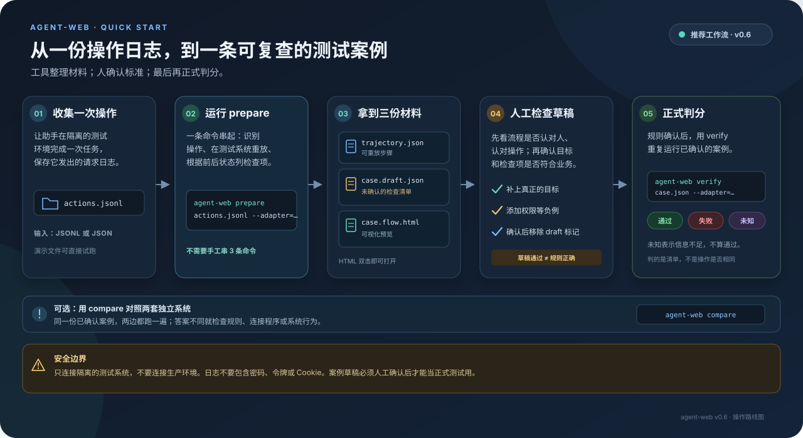

# agent-web

**让智能助手做完事情后，用清楚的规则检查结果。**

[中文](README.md) · [English](README.en.md)

智能助手能帮人下单、处理工单、更新库存。难的是：怎么确认它真的做对了？

agent-web 像一位按清单检查的质检员：先说明「什么结果才算做对」，再让助手做事，最后检查实际结果。它不凭语气、印象或另一个模型的评分下结论。

**一句话：同一张考卷，可以考不同的系统；判分规则不变，结果就能公平比较。**

---

## 这个项目真正在管的东西

大部分评测工具在做「造更多题目、造更真的环境」。这个项目做的是另一件事：**让判决本身值得相信**。

下面四件事缺一件，全绿的判决就重新变成「看起来没问题」：

| 机制 | 挡住什么 |
| --- | --- |
| 三种结果，`unknown` 留在分母里 | 「不知道」被悄悄算成通过 |
| 18 条判决顺序，先命中先返回 | 同一条案例在两个实现上报出不同的原因 |
| 跨实现对照（`compare`） | 测量对象被换掉了，而每一步都合法 |
| 假绿审计（`audit`） | 判决器自己漏判，却没人知道漏了多少 |

而且它得敢承认自己被绕过。`docs/museum` 收藏了六种假通过，每一件都能跑出「没有这个机制时会怎样」——包括一次真实事故：适配器把「另一位顾客」悄悄换成了下单人本人，于是那条案例稳定地判 `pass`，而它想测的事情一次也没测到。

```
docs/museum/README.md
```

---

## 它会给出三种结果

| 结果 | 日常说法 | 例子 |
| --- | --- | --- |
| `pass` | 通过 | 订单已下好，也由正确的人取走 |
| `fail` | 没通过 | 订单还没准备好，助手却说已经完成 |
| `unknown` | 现在无法判断 | 系统没有提供相关信息，或测试连接出了问题 |

「不知道」不等于「做错了」，也不等于「做对了」。所以 `unknown` 单独记录，不会被算成通过：

```text
可判断比例 = (通过 + 没通过) / 全部案例数
无法判断比例 = 无法判断 / 全部案例数
```

这样不会因为测不出来，就把成绩涂成绿色。

---

## 用一杯咖啡看懂它

题目：顾客下单，店员接单并做好，**下单的顾客本人**取走咖啡。

检查清单可以写成：

1. 订单数量增加一笔。
2. 订单最后状态是「已取走」。
3. 订单经过「制作中 → 可取 → 已取走」这些状态。
4. 其他顾客不能取走这笔订单。

助手可能用不同步骤完成任务，只要最终结果符合规则就可以通过。反过来，步骤看起来很像、结果却不对，就不能通过。

---

## 3 分钟试跑

需要 Node.js 20 或更新版本，不需要安装额外依赖。

```bash
git clone https://gitee.com/liu-everything_impossble/agent-web.git
cd agent-web

# 跑内置样例，不连接外部服务
node bin/agent-web.mjs selftest

# 检查一条具体案例
node bin/agent-web.mjs verify cases/coffee/happy-path.json --adapter=memory
```

`selftest` 会跑 7 条样例：正常完成、越权、漏步骤和无法判断等情况。样例通过表示程序的基本判分流程正常，不代表所有真实系统都已测过。

---

## 使用指南：从日志到正式判分



助手已经跑过一次，并且你拿到了它发出的请求日志？最短路径是：日志 → `prepare` → 人工检查 → `verify`。`prepare` 一次生成可重放步骤、待确认案例草稿和流程预览：

```bash
node bin/agent-web.mjs prepare examples/agent-traces/memory-happy-path.jsonl \
  --adapter=memory \
  --id=coffee/happy-path \
  --goal="顾客下单后由本人取走" \
  --out-dir=agent-web-output/coffee-happy-path
```

结束后会得到：

```text
agent-web-output/coffee-happy-path/
├── trajectory.json     从日志还原的操作步骤
├── case.draft.json     根据实际结果生成的待确认检查清单
└── case.flow.html      可双击打开的流程预览
```

按这个顺序接手：

1. 打开 `case.flow.html`，先看每一步有没有认错人、认错操作。
2. 检查 `case.draft.json` 里的目标、检查项和「待确认」提示；草稿描述的是这次发生了什么，**自检通过不等于规则正确**。
3. 补上真正的业务目标和负例（例如别人不能取走订单），确认后再用 `verify` 检查。

`prepare` 会在你指定的测试适配器上重放日志里的写操作，所以只连隔离的测试环境，**不要指向生产系统**。疑似密码、令牌、Cookie 等敏感字段会让流程停止，不会写入产物。若输出文件已存在，也会停止，不覆盖旧文件。

演示日志用简化格式：写清操作名、角色、结果和参数，不需要网络地址。真实 HTTP 日志也能处理，但适配器必须先声明接口地址如何对应操作、请求参数如何转换。要接入自己的服务，把 `--adapter=memory` 换成自己的连接程序，并使用专用测试环境。

检查草稿后，补好目标并添加必要的负例。人工确认完成时，删掉案例 JSON 最后的 `draft` 注记，再运行：

```bash
node bin/agent-web.mjs verify agent-web-output/coffee-happy-path/case.draft.json --adapter=memory
```

这一步能证明案例可执行、格式正确；业务检查项是否完整，仍以人工确认结果为准。

---

## 把助手做过的步骤拿来检查

案例自带的步骤是参考答案，不一定是助手实际走过的路。要检查助手自己的操作记录，先运行：

```bash
node bin/agent-web.mjs verify cases/coffee \
  --adapter=memory \
  --trajectory=examples/candidate-trajectories \
  --out=candidate-results.jsonl
```

这里的 `--trajectory` 指向助手实际步骤的文件夹；`--out` 把每条案例的判分结果保存起来。仓库带有两条演示步骤：一条只下单就停下，另一条补做一步后达成目标。

**检查的是结果，不是动作是否照抄参考答案。** 参考步骤没完成目标，而助手换了一条路完成了，助手仍然可以通过。

---

## 进阶：把 prepare 拆成单独步骤

平常直接使用 `prepare`。需要检查中间文件或替换某一步时，再分别运行 `record`、`draft` 和 `flow`：

```bash
# 1. 请求日志 → 可重放步骤
node bin/agent-web.mjs record examples/agent-traces/memory-happy-path.jsonl \
  --adapter=memory \
  --out=agent-web-output/coffee/trajectory.json

# 2. 可重放步骤 → 待确认案例草稿
node bin/agent-web.mjs draft agent-web-output/coffee/trajectory.json \
  --adapter=memory \
  --id=coffee/happy-path \
  --goal="顾客下单后由本人取走" \
  --out=agent-web-output/coffee/case.draft.json

# 3. 案例草稿 → 流程预览
node bin/agent-web.mjs flow agent-web-output/coffee/case.draft.json \
  --out=agent-web-output/coffee/case.flow.html
```

确认草稿规则后，删除案例 JSON 最后的 `draft` 注记，再跑正式检查：

```bash
node bin/agent-web.mjs verify agent-web-output/coffee/case.draft.json \
  --adapter=memory --out=agent-web-output/coffee/results.jsonl

# 用正式判分结果更新流程图，显示实际结果与事件
node bin/agent-web.mjs flow agent-web-output/coffee/case.draft.json \
  --result=agent-web-output/coffee/results.jsonl \
  --out=agent-web-output/coffee/case.flow.html
```

如果检查的是候选轨迹（助手实际走过的步骤），`--result` 必须来自同一条候选轨迹；不要把参考步骤的判分贴到候选步骤上。参考 [候选步骤检查](#把助手做过的步骤拿来检查) 的完整命令。

这三个命令也可单独用来处理真实 HTTP 请求：`record` 需要适配器先声明 URL 与操作的对应关系，并提供参数转换方法。日志至少要记录操作者、请求方法和地址；最好保留请求内容与响应结果。不要记录密码或令牌。后续步骤引用前一步产生的订单编号；无法识别的请求会列出跳过原因，不会猜。

流程图是独立 HTML，双击即可打开。页面展示步骤、角色、预期与实际结果、状态变化和检查结果；支持筛选、展开参数、键盘操作和浅/深主题。敏感参数会遮盖，页面只展示数据，不会再次执行操作。

**草稿自检通过不代表规则正确。** 它从这次实际发生的事情生成检查项，所以重放通过并不意外。正式使用前，人工确认目标、检查规则、负例和权限边界。

---

## 用同一题比较两套系统

agent-web 自带一个内存里的演示系统，也能连接咖啡店示例后端。两边用同一批案例：

```bash
# 咖啡店示例服务须先在本机 8080 端口运行
TAIXIANGLIAN_BASE_URL=http://127.0.0.1:8080 \
  node bin/agent-web.mjs compare cases/coffee \
  --adapters=memory,taixianglian
```

示例结果：

```text
案例                           内存样例      咖啡店服务    结果相同
coffee/happy-path             pass          pass          ✓
coffee/foreign-pickup         fail          fail          ✓
coffee/unknown-capability     unknown       unknown       ✓

同一案例判分一致率 100.0% (7/7)
```

两边答案不同，不表示哪边一定有问题；它提醒你检查：案例规则是否说清楚、连接方式是否把顾客 A 和顾客 B 当成了不同的人、或两个系统的实际行为是否不同。

这套对照曾抓到一个真实问题：案例说「顾客 B 去取」，判分结果却说通过。检查后发现，不是咖啡店放错了咖啡，而是连接程序把顾客 A 和 B 都当成顾客 A，实际执行的是「A 取自己的订单」。它测错了人，判分却看起来完全正常。换另一套独立实现后结果对不上，才暴露了这个问题。完整经过见 [事故记录](docs/FINDING-001.md)。

---

## 拿真实后端当尺子：假绿审计

「两份判决一致」只是观察，不是证明。真正的尺子要来自另一个实现：真实后端判 `fail` 的案例，新实现也判 `fail`，这份判决才算可信。

```bash
# 1. 两次跑批各自存档
TAIXIANGLIAN_BASE_URL=http://127.0.0.1:8080   node bin/agent-web.mjs verify cases/coffee --adapter=taixianglian --out=real.jsonl
node bin/agent-web.mjs verify cases/coffee --adapter=memory --out=memory.jsonl

# 2. 以真实后端为 oracle，审另一份判决
node bin/agent-web.mjs audit real.jsonl memory.jsonl --detail
```

输出是一张混淆矩阵：

| 格子 | 含义 | 危险程度 |
| --- | --- | --- |
| 一致·通过 | 两边都说没问题 | — |
| 一致·未通过 | 两边都说有问题 | — |
| **假绿** | 真的有问题，候选却说没问题 | 最危险：会稳定变绿 |
| 假红 | 真的没问题，候选说有问题 | 吵，但不危险 |
| 漏判 | 真实后端判得出，候选判不出 | 证据不足 |

只要出现一条假绿，`audit` 就退出码 1。这不是口味问题：假红会让人去查，漏判会被老实记成 `unknown`，只有假绿能让一份不能用的判决看起来完美。

对着真实咖啡店后端跑，当前是 6 条能判、假绿 0 条；把其中一条 `fail` 手工改成 `pass` 再跑，它立刻变红并点出是哪条。

## 草稿必须先过人手

`draft` 从一条真实轨迹反推案例，产物带着 `draft.status: "unconfirmed"`。**这种案例不产生判决**，一律记 `unknown / unconfirmed_draft`——机器生成的考卷，没人核对过就不能拿来评分。

确认一次，它才是一张考卷：

```bash
node bin/agent-web.mjs accept cases/coffee/my-draft.json --by=YG
# 已确认 cases/coffee/my-draft.json
#   draft.status: unconfirmed → confirmed
#   reviewed_by:  YG
#   reviewed_at:  2026-11-04T07:41:16.195Z
```

不接受匿名确认（`--by` 必填）：「有人看过」如果无法指认，就等于没人看过。手写案例没有 `draft` 字段，不受影响。

## 案例只存一份

`cases/coffee/` 不按实现复制。同一目录换 `--adapter` 就能打不同实现：

```bash
node bin/agent-web.mjs verify cases/coffee --adapter=memory
node bin/agent-web.mjs verify cases/coffee --adapter=taixianglian
```

案例描述的是「一个咖啡店点单系统该有的行为」，跟谁实现无关。把它按实现复制成两份，等于给自己造两个会慢慢分叉的真相——FINDING-001 那次假通过，起因就是「两份实现被当成一份来对照」。

---

## 发现系统版本变化

同一条案例，系统升级前后可能遇到不同的初始数据。先分别保存两次测试结果，再比较：

```bash
node bin/agent-web.mjs verify cases/coffee --adapter=memory --out=before.jsonl
# 应用更新后再跑一次，保存为 after.jsonl
node bin/agent-web.mjs verify cases/coffee --adapter=memory --out=after.jsonl
node bin/agent-web.mjs drift before.jsonl after.jsonl
```

`drift` 检查测试开始时看到的数据是否变化。发现变化时，表示需要复查案例是否还适合新版系统；它不是在说这次测试判错了。

---

## 接入自己的系统

用 `--adapter` 指向一个小型连接程序：

```bash
node bin/agent-web.mjs verify my-cases --adapter=./my-adapter.mjs
```

仓库里的 `examples/adapter-template/` 有可运行样例。这个连接程序负责五件事：

| 方法 | 做什么 |
| --- | --- |
| `manifest()` | 告诉工具能做哪些操作、能查看哪些数据 |
| `reset()` | 准备一份干净的测试数据 |
| `observe()` | 读出当前订单、库存等状态 |
| `execute()` | 让系统执行一步操作 |
| `close()` | 结束并清理本次测试资源 |

具体代码和案例格式见 [接入样例](examples/adapter-template/README.md) 与 [详细格式说明](docs/SPEC.md)。

---

## 这套案例碰到了系统的多少面

判决只回答「这几条案例过得怎么样」，回答不了「这些案例有没有把系统测遍」。`coverage` 把 manifest 声明的能力和案例真正用到的能力对上账：

```bash
node bin/agent-web.mjs coverage cases/coffee --adapter=memory --detail
```

```text
一、能力对账
  声明能力        9
  被案例用到      6
  从未被用到      3   ← 不是 bug，只说明案例还没碰到它
  案例要但没声明  1   ← 是缺口，这类步只会判 unknown
  覆盖率          66.7%   = 被用到的能力 / 声明的能力
```

两个数字必须分开看：**闲置**只说明案例还不够狠，**缺口**是判决永远拿不到证据。仓库自带案例里那条 `unknown-capability` 就是故意留的缺口（它演示的正是 `coverage_gap`），所以对 `cases/coffee` 跑必然报 1 条缺失、退出码 1 —— 这不是脏数据。

`--min=0.8` 可以当门槛：缺口为 0 且覆盖率达标才算通过。观测域单独一栏——案例要读某个集合而 manifest 没声明它，那些断言只能是 `unknown`。

## 适配器是可执行代码

`--adapter=./xxx.mjs` 不是读一份配置，是把那个文件当普通 Node 模块 `import` 进来。它在你机器上、以你的身份运行：能读环境变量（包含你的 token）、读写文件、发网络请求。

所以：

- 只加载你信得过的适配器，尤其是别人连同案例集一起给你的那种
- 第一次跑之前先打开看一眼。它顶多几百行，`fetch` / `fs` 出现在哪儿一眼就能找到
- 加载外部适配器时 agent-web 会先打一行提醒；确认了解后可用 `AGENT_WEB_QUIET_ADAPTER_WARNING=1` 关掉

内置的 `memory` 与 `taixianglian` 不走外部加载，不会有这行提示。

## 术语对照

代码中保留固定英文名字，文档用日常说法解释：

| 代码里的词 | 简单解释 |
| --- | --- |
| Case（案例） | 一道题：目标、检查规则和参考步骤 |
| Trajectory（步骤记录） | 助手实际做过的一连串操作 |
| Adapter（连接程序） | 把测试工具接到真实系统上的小程序 |
| Assertion（检查项） | 能用明确事实回答「对 / 不对」的规则 |
| `unknown` | 目前没有足够信息判分 |
| Reset（重置） | 为下一次测试准备全新的数据，避免上次结果干扰 |

---

## 能检查什么

| 检查项 | 日常说法 |
| --- | --- |
| `entity_exists` | 有没有出现指定记录 |
| `field_equals` | 某个字段是不是指定内容 |
| `count_delta` | 记录数量前后增加或减少多少 |
| `unchanged` | 某些数据前后有没有改变 |
| `status_transition` | 状态有没有经过指定的变化 |
| `event_absent` | 整个过程中有没有发生禁止的事件 |
| `composite` | 把多个检查项用「并且 / 或者 / 不是」组合起来 |

它能检查订单状态、记录数量和事件记录等明确事实；不判断页面好不好看、回答有没有文采、或主观上「感觉是否合适」。这些没有清楚标准的部分，不会被伪装成机器判分。

---

## 当前限制

- 每种真实系统都要有人编写连接程序；目前不能只给一个网址就自动接入。
- 不同系统里的数据名称需要通过连接程序统一；目前不会自动把 `orders` 和 `tickets` 对应起来。
- 现在主要检查操作结束后的结果和已记录的事件；例如「点了三次才点对」这种过程质量还无法完整衡量。
- 测试按顺序执行，目前没有多机并行运行。
- 草稿只能根据已发生的事情列清单；禁止行为、权限边界和时间要求仍需要人工补充。

---

## 项目文件

```text
bin/agent-web.mjs       命令行入口
src/                   判分、案例、记录、草稿和流程图代码
cases/                 内置测试题
examples/              可运行的连接样例与日志
  agent-traces/memory-happy-path.jsonl   可直接试用 prepare 的简化日志
docs/SPEC.md            案例文件的详细格式
test/engine.test.mjs    自动测试（49 条）
```

常用命令：`prepare`（一条命令生成步骤、案例草稿和流程预览）、`selftest`（跑内置检查）、`verify`（检查案例）、`compare`（比较不同系统）、`record`（整理请求记录）、`draft`（单独生成案例草稿）、`flow`（生成流程图）、`drift`（比较两次初始数据是否变化）。运行 `node bin/agent-web.mjs help` 查看完整命令。

---

## 往 GitHub 镜像推送

仓库在 Gitee 和 GitHub 各有一份。如果这台机器的 `hosts` 把 `github.com` 指到了 `127.0.0.1`（症状：`curl https://github.com` 返回 `000`，而 `dns` 和 `conn` 都只有几毫秒、`tls` 是 `0`），`git push github` 会卡在 TLS 握手。改 `hosts` 要管理员权限，还可能被写这些行的脚本覆盖回去。

`scripts/gh-proxy.mjs` 绕开它：把域名用 DNS 单独解析一次（跳过 `hosts`），再建隧道原样转发。TLS 仍是 git 与 GitHub 端到端握手，SNI 不变，证书校验正常，不需要关掉任何校验。

```bash
node scripts/gh-proxy.mjs &                                     # 127.0.0.1:8899
git -c http.proxy=http://127.0.0.1:8899 push github main
# 只给这一个远端设上，省得每次带参数（代理关掉后记得删掉这条配置）
git config --local http.https://github.com.proxy http://127.0.0.1:8899
```

地址会逐个试（DNS 结果 + 一小份备用地址），GitHub 的 IP 时通时不通，必要时 `node scripts/gh-proxy.mjs --ip=140.82.114.4` 直接指定。它只监听本机，用完关掉即可。**这不是给用户用的东西**，是维护者在这台机器上发版时的临时通道。

---

## 版本与后续

当前版本 `0.9`：可以跑案例、检查助手实际操作，从请求日志生成可重放步骤与待确认草稿，管住「判决本身可不可信」（案例只存一份、草稿必须过人、假绿审计能把看起来全绿的判决判红），并且能算出这套案例到底碰到了系统的多少面。

后续方向：让不同数据结构的系统更容易共用案例、让多套系统并行测试、把参考实现与真实后端的对照做成可订阅的回归，以及让「根据现象推测出来的能力」能通过验证升级为「实际验证过的能力」。

MIT 许可，见 [LICENSE](LICENSE)。
