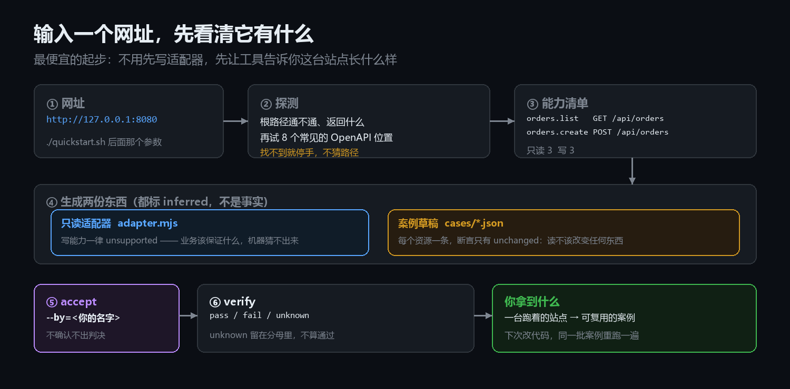
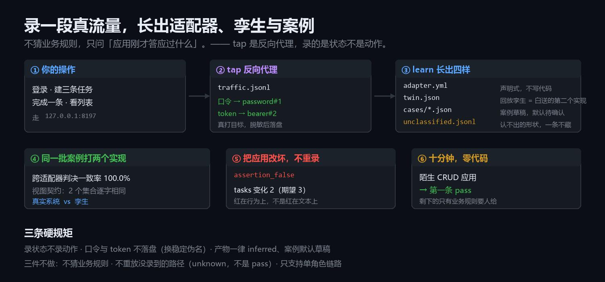
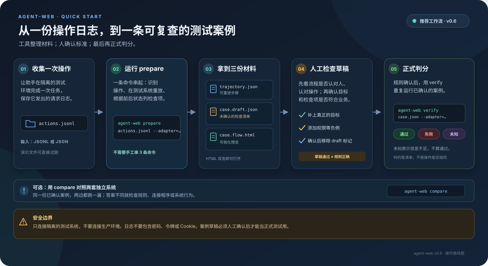

# 详解

> 这是一篇长文。**先按身份挑入口，不必通读**：
>
> - **我想 3 分钟跑起来** → [3 分钟试跑](#3-分钟试跑)，跑完回 README 的「六十秒上手」
> - **手上有接口、有日志，想长出案例** → [从一个网址开始](#从一个网址开始) · [录一段流量](#录一段流量把它变成适配器) · [从日志到正式判分](#使用指南从日志到正式判分)
> - **想理解断言与判决凭什么可信** → [断言凭什么被收下](#断言凭什么被收下判据准入) · [体检报告](#体检报告这批判决有多少条在盲区里)
> - **想知道它做不了什么** → [为什么没有并发开关](#为什么没有并发开关)，以及 [LIMITS.md](LIMITS.md) 的十一条台账
- **想查命令、字段、断言、适配器怎么写** → 命令速查 · 案例怎么写 · 断言速查 · 适配器五方法
> - **我是要改这个仓库的 Agent** → 先读 [AGENTS.md](../AGENTS.md)，这里只查细节

README 只放入门和目录。这一份是完整说明：每条命令的细节、判决顺序表怎么来的、遇到过的坑怎么修的、以及为什么有些看起来该做的东西没有做。

内容与当前 README 一致，后续新增能力会先补 README 的短说明，再补到这里。

---

## 这个项目真正在管的东西

大部分评测工具在做「造更多题目、造更真的环境」。这个项目做的是另一件事：**让判决本身值得相信**。

下面四件事缺一件，全绿的判决就重新变成「看起来没问题」：

| 机制 | 挡住什么 |
| --- | --- |
| 三种结果，`unknown` 留在分母里 | 「不知道」被悄悄算成通过 |
| 18 条判决顺序，先命中先返回 | 同一条案例在两个实现上报出不同的原因 |
| 跨实现对照（`compare`） | 测量对象被换掉了，而每一步都合法 |
| 假绿审计（`audit`） | 判决器自己漏判，却没人知道漏了多少 |

而且它得敢承认自己被绕过。`docs/museum` 收藏了六种假通过，每一件都能跑出「没有这个机制时会怎样」——包括一次真实事故：适配器把「另一位顾客」悄悄换成了下单人本人，于是那条案例稳定地判 `pass`，而它想测的事情一次也没测到。

```
docs/museum/README.md
```

---

## 它会给出三种结果

| 结果 | 日常说法 | 例子 |
| --- | --- | --- |
| `pass` | 通过 | 订单已下好，也由正确的人取走 |
| `fail` | 没通过 | 订单还没准备好，助手却说已经完成 |
| `unknown` | 现在无法判断 | 系统没有提供相关信息，或测试连接出了问题 |

「不知道」不等于「做错了」，也不等于「做对了」。所以 `unknown` 单独记录，不会被算成通过：

```text
可判断比例 = (通过 + 没通过) / 全部案例数
无法判断比例 = 无法判断 / 全部案例数
```

这样不会因为测不出来，就把成绩涂成绿色。

---

## 用一杯咖啡看懂它

题目：顾客下单，店员接单并做好，**下单的顾客本人**取走咖啡。

检查清单可以写成：

1. 订单数量增加一笔。
2. 订单最后状态是「已取走」。
3. 订单经过「制作中 → 可取 → 已取走」这些状态。
4. 其他顾客不能取走这笔订单。

助手可能用不同步骤完成任务，只要最终结果符合规则就可以通过。反过来，步骤看起来很像、结果却不对，就不能通过。

---

## 3 分钟试跑

需要 Node.js 20 或更新版本，不需要安装额外依赖。

```bash
git clone https://gitee.com/liu-everything_impossble/agent-web.git
cd agent-web

# 跑内置样例，不连接外部服务
node bin/agent-web.mjs selftest

# 检查一条具体案例
node bin/agent-web.mjs verify cases/coffee/happy-path.json --adapter=memory
```

`selftest` 会跑 7 条样例：正常完成、越权、漏步骤和无法判断等情况。样例通过表示程序的基本判分流程正常，不代表所有真实系统都已测过。

---

## 命令速查：三十三条命令各管什么

所有命令都是 `node bin/agent-web.mjs <命令>`，零依赖、没有安装步骤。表按「先会判、再会出题、再会抓谎」的顺序排；两级命令（`drill grade`、`import hurl`）按全名一行。

| 命令 | 干什么 | 什么时候用 |
| --- | --- | --- |
| `selftest` | 零依赖自测：内置适配器 + 内置案例 | 克隆后第一跑，判分流程活着没 |
| `verify` | 跑案例出判决 | 日常主命令，单条或整目录 |
| `report` | 由 results.jsonl 出指标 | 跑完一批看三值分布 |
| `accept` | 确认草稿，确认后才能判决 | draft / prepare 之后的人关 |
| `capabilities` | 打印能力清单与证据等级 | 接新适配器先看它声明了什么 |
| `coverage` | 能力覆盖率对账（`--min` 设门槛） | 想知道案例碰到了系统多少面 |
| `probe` | 探针：查适配器自己有没有在撒谎 | 信任任何适配器之前必跑 |
| `certify` | 判据准入：变异体 × 断言杀伤矩阵 | 证明「这条断言有用」 |
| `breed` | 照着视图形状自动生成变异体 | 变异体不够时补 |
| `drill` | 出题：对真盲区出题（题面不含答案） | 把盲区变成考题 |
| `drill grade` | 批改：只认跑出来的结果 | 收 drill 的答卷 |
| `compare` | 同一份案例喂多个实现，比判决 | 双实现对照的核心 |
| `drift` | 比较两次跑批的初态形状 | 升级后区分漂移与见证 |
| `record` | 把 Agent 的实际动作还原成候选轨迹 | 手上有一份动作日志 |
| `prepare` | 一次生成步骤、案例草稿和流程预览 | 日志到案例的快路径 |
| `draft` | 回放轨迹，反推案例草稿（要人确认） | 手上有一份轨迹文件 |
| `flow` | 单案例流程图；给目录则生成判决总览 | 要给人看判决过程时 |
| `crosscheck` | 交叉复核：不经过适配器自己的 fetch 再发一遍 | 抓 fetch 层的谎 |
| `discover` | 探一个站点：生成只读适配器、案例草稿和施工单 | 只有一个网址时 |
| `import hurl` | 把 hurl 套件转成案例草稿（不联网） | 有现成 hurl 套件 |
| `tap` | 录五分钟：流量长出适配器、孪生与案例 | 录一个活站点 |
| `learn` | 把录制学成四样（yaml/孪生/案例/认不出的） | tap 之后的加工 |
| `mutants` | 变异体目录：谁的坏法、怎么抓、怎么投稿 | 查变异体、投新变异体 |
| `ingest` | 把别家测试报告翻成三值判决 | 消费外部报告 |
| `align` | 跨命名体系的字段映射提议 | 两套视图名字对不上 |
| `negatives` | 按声明派生负例候选（全部 disputed） | 出拒绝类案例的审阅表 |
| `preflight` | 跑之前预检：预测 ready / unknown / fail | 跑批前与预期对账 |
| `audit` | 假绿审计：拿真实后端当尺子 | 量一个候选实现 |
| `gate` | 四行口径门禁：覆盖率/抗变异/独立证据/unknown | CI 门禁，缺行即红 |
| `traps` | 陷阱普查：这批判决有多少是盲的 | 跑批后自查盲区 |
| `knowledge` | 事故档案：这个仓库踩过的坑 | 查旧坑 |
| `recall` | 比对档案：这次有没有重犯旧错 | 第二次犯同一个错时拦下 |
| `init` | 生成案例模板 | 开新域 |
| `version` | 版本、最近一次变更、版本号三处是否一致 | 发版前自检 |

---

## 案例怎么写：一份文件里有什么

案例是一份 JSON，放在 `cases/<域>/` 下，唯一执行入口是 `verify`。文件四块：环境（跑在哪个适配器上）、可观测声明（允许看哪些 scope）、参考轨迹（步骤）、断言（goal 与不变量）。

| 字段 | 含义 | 必填 |
| --- | --- | --- |
| `id` | 案例名，域内唯一 | 是 |
| `environment.adapter` | 内置名或适配器路径 | 是 |
| `environment.seed` | 复位种子（reseed 策略的适配器用） | 否 |
| `environment.clock_policy` | 时钟策略声明 | 否 |
| `observability.declared_scopes` | 声明要看的 scope；没声明的进 unknown 分母 | 建议 |
| `reference_trajectory[]` | 参考步骤：`id`（s1 起） / `capability` / `arguments` / `as` / `expected_outcome`（applied 或 rejected） | 是 |
| `task.goal_assertions` | 终态断言数组；集合与行写在 `selector`（`collection` + 可选 `index`），字段路径走 `path` | 是 |
| `task.invariants` | 不变量断言数组（跨步骤求值） | 否 |

`as` 是角色身份，适配器必须真的按它切换身份；忽略它会让越权案例假通过——本仓库踩过两次，见「先问一句：这个适配器有没有在撒谎」。

最小案例长这样：

```json
{
  "schema_version": "agent-web/0.1",
  "id": "mydom/my-first-case",
  "environment": { "adapter": "memory", "seed": {} },
  "observability": { "declared_scopes": ["orders"] },
  "reference_trajectory": [
    { "id": "s1", "capability": "order.create", "arguments": { "items": [{ "dishName": "拿铁", "qty": 1 }] }, "as": "customer", "expected_outcome": "applied" },
    { "id": "s2", "capability": "order.list", "arguments": {}, "as": "customer", "expected_outcome": "applied" }
  ],
  "task": {
    "natural_goal": "顾客下单后，订单出现在自己的列表里，停在 PENDING",
    "goal_assertions": [
      { "kind": "count_delta", "selector": { "collection": "orders" }, "delta": 1, "label": "下单后多一条订单" },
      { "kind": "field_equals", "selector": { "collection": "orders", "index": 0 }, "path": "status", "value": "PENDING", "label": "新订单停在 PENDING" }
    ]
  }
}
```

跑它与预检：

```bash
node bin/agent-web.mjs verify cases/mydom/my-first-case.json --adapter=memory
node bin/agent-web.mjs preflight cases/mydom --adapter=memory
```

每个域目录还有一份 `expected.json`：`"域/案例id": "pass|fail|unknown"` 的平面映射。它是 compare 与 certify 的基线——改判决必须同一次提交改它，否则守卫会红。

---

## 断言速查：二十一种 kind 各判什么

相位只有三个值：`final` 看终态视图，`trace` 看每一步的执行记录，`initial_vs_final` 看前后两份快照的差。每种 kind 的相位由矩阵固定，改它会把正常实现判红——比如关系式按 trace 求值，会在「新订单还没算出总额」的那一瞬间判红。

| kind | 判什么 | 相位 |
| --- | --- | --- |
| `entity_exists` | 视图里出现符合形状的行 | final |
| `field_equals` | 某字段值等于期望 | final |
| `count_delta` | 前后行数变化 | initial_vs_final |
| `status_transition` | 流水里出现 from→to 迁移 | trace |
| `unchanged` | 集合前后完全没变 | initial_vs_final |
| `event_absent` | 某事件全程没出现 | trace |
| `composite` | 子断言的与 | 随子断言 |
| `relation` | 关系式：eq / sum_equals / product_equals / sorted | final |
| `sorted_by` | 某列单调 | final |
| `unique` | 某列无重复值 | final |
| `type_of` | 字段类型 | final |
| `subset` | 集合包含 | final |
| `window` | 步骤窗口内才求值内层断言 | trace |
| `every_step` | 每一步内层断言都成立 | trace |
| `pagination` | 翻页返回：不重 / 不漏 / 不乱 | trace |
| `payload` | 步骤返回的形状与 op | trace |
| `linkage` | 跨集合行联动（必须写 expect） | final |
| `timeliness` | 事件时间戳落在窗口内 | final |
| `state_machine` | 流水走过的每条边合法 | trace |
| `recurrence` | 周期任务槽位序列：不重跑 / 跑偏 / 漏跑 | final |
| `precedence` | 流水行相对顺序（允许中间夹行） | final |

新增一种 kind 必须过判据准入：先造一个只有它能杀的变异体，杀不掉就不加。当前二十一种的必要性反证都在 `scripts/kind-necessity.mjs` 里，跑一次能看到「摘掉它谁就漏网」。

---

## 适配器怎么写：五方法契约

适配器是案例与被测系统之间唯一的桥，它是可执行代码（见「适配器是可执行代码」）。契约五个方法：

| 方法 | 签名 | 责任 |
| --- | --- | --- |
| 复位 | `reset()` → `{runId, state, roleBindings, reset_note}` | 把环境回到声明的初态 |
| 观测 | `observe(runId)` → 规范视图 | 只读投影，断言的唯一事实来源 |
| 执行 | `execute(runId, {capability, arguments, as})` → `{outcome, ...}` | 执行一步；第一参是 runId，不是能力名 |
| 分类 | `classify(capability)` → `read` 或 `write` | 告诉 runner 这一步改不改状态 |
| 收尾 | `close(runId)` | 释放资源，必须幂等 |

最小骨架：

```js
export function createMyAdapter(options = {}) {
  const runs = new Map();
  return {
    async reset() {
      const runId = 'r' + Date.now();
      runs.set(runId, { orders: [] });
      return { runId, state: runs.get(runId), roleBindings: { customer: 'u1' }, reset_note: '空表' };
    },
    async observe(runId) {
      const s = runs.get(runId);
      return { orders: s.orders.map((o) => ({ id: o.id, status: o.status })) };
    },
    async execute(runId, action) {
      const s = runs.get(runId);
      if (action.capability === 'order.create') {
        if (action.as !== 'customer') return { outcome: 'rejected', reason_code: 'forbidden' };
        s.orders.push({ id: s.orders.length + 1, status: 'PENDING' });
        return { outcome: 'applied', orderId: s.orders.length };
      }
      return { outcome: 'unsupported', reason_code: 'unknown_capability' };
    },
    classify: (capability) => (capability === 'order.create' ? 'write' : 'read'),
    async close(runId) { runs.delete(runId); },
  };
}
```

在 `src/adapter/load.mjs` 的 `BUILTINS` 里登记名字，然后先探针后判决：

```bash
node bin/agent-web.mjs probe --adapter=myadapter
node bin/agent-web.mjs verify cases/mydom --adapter=myadapter
```

两句实话：视图里不要放本轮专属的值（自增 id、时间戳走投影或声明 derived）；`execute` 忽略 `action.as` 会让越权案例假通过。这两条都是本仓库的真实事故，probe 的 role-effective 检查与越权案例各守一条。

---

## 从一个网址开始



前面几节都假定你手上已经有一份日志。但更多时候你手上只有一台跑着的站点，别人给你的，或者你自己很久没碰的那个。
这时候最便宜的一步不是写适配器，是先让工具把「这台站点有什么」列出来。

```bash
git clone https://gitee.com/liu-everything_impossble/agent-web.git
cd agent-web
./quickstart.sh http://127.0.0.1:8080
```

Windows 用 `pwsh -File quickstart.ps1 http://127.0.0.1:8080`。没有依赖，只要有 Node 20 以上。

### 它会跑出什么

```
探测 http://127.0.0.1:8199

  根路径  200  text/html  62 字节  演示订单服务
  接口描述  http://127.0.0.1:8199/openapi.json  演示订单服务 1.0.0

  探测到 6 个接口：只读 3，写 3
    R  menu.list                GET /api/menu
    R  orders.list              GET /api/orders
    R  orders.get               GET /api/orders/{id}
    W  orders.create            POST /api/orders
    W  orders.delete            DELETE /api/orders/{id}
    W  menu.image               POST /api/menu/{id}/image

  实跑 3 个只读接口：
    OK    200 1ms    1 行     menu.list
    OK    200 2ms    2 行     orders.list
    SKIP  需要路径参数    orders.get  GET /api/orders/{id}
    2/2 可用，1 个需要参数没打
```

三行字加起来就回答了三件事：这台机器通不通、接口在哪、哪些接口现在真的能用。

### 生成的两份东西

```text
agent-web-site/
├── adapter.mjs           只读适配器，立刻能跑
└── cases/
    ├── menu-readonly.json
    └── orders-readonly.json
```

适配器是全的：五个方法都在，`manifest()` 通过校验，默认 `reset_strategy` 是 `identity`。
案例每个资源一条，断言只有一条 —— `{ "kind": "unchanged", "scopes": ["orders"] }`：读操作不该改变任何东西。

先把这两份当成**别人写给你的初稿**：格式对、能跑，但里面每一个判断都是机器推的。

### 三条它明确不做的

**一、不猜写操作该保证什么。** 看到 `POST /orders` 能知道「会创建一个订单」，推不出「同一个人对同一个订单重复下单该不该被拒」。
前一句写在接口描述里，后一句是产品决策。所以生成的适配器对所有写能力返回 `unsupported`，
而不是假装成功 —— 假装成功会让判决变成绿灯，那比缺能力坏得多。

**二、不猜路径。** 站点没有 OpenAPI 时它**不会**去试 `/api/orders`、`/api/users` 这类常见路径。
猜出来的 404 会变成案例里的假失败，而假失败比缺案例更坏：它让人开始不信任这套工具。那种情况它只做一件事 —— 告诉你改走 `prepare`。

**三、带参数的接口不去打。** `/api/orders/{id}` 拿不到真实 id，硬拼一个去打必然 404。它把这类标成 `SKIP 需要路径参数`，
单独计数，不算进「可用 / 不可用」的分母。

### 三个数字怎么读

| 行 | 意思 | 什么时候要担心 |
| --- | --- | --- |
| `R` / `W` | 只读 / 会改状态的接口 | —— |
| `OK` | 真的打通了、返回 JSON | 大面积 `OK` 但行数是 0，说明接口通而数据空，案例会测得很虚 |
| `SKIP` | 需要路径参数，没打 | 从不担心。这是有意的 |

### 然后是这四步

```bash
# 1. 看一眼生成的适配器和案例（生成的东西都标了 inferred，别当事实）
ls agent-web-site/cases

# 2. 自检适配器：查它有没有在基本行为上自相矛盾
node bin/agent-web.mjs probe --adapter=agent-web-site/adapter.mjs

# 3. 确认案例。不确认不出判决，确认人会被写进文件
node bin/agent-web.mjs accept agent-web-site/cases/orders-readonly.json --by=你的名字

# 4. 跑判决
node bin/agent-web.mjs verify agent-web-site/cases --adapter=agent-web-site/adapter.mjs
```

第 2 步值得单独说：探针跑六项检查（契约、复位幂等、观测稳定、无状态泄漏、空参不炸、写了要变），
生成的适配器在这六项上应当全绿。它证明的是「这份观测在能机械检查的范围内自洽」，
不证明它没在别处撒谎 —— 那件事只能靠读代码和跨实现对照。

第 3 步也别跳。不确认时的判决是 `unknown / unconfirmed_draft`，
留在分母里，可判定率会难看 —— 这是故意的。

### 站点没有 OpenAPI 怎么办

大多数内部系统都没有。这时报告是这样的：

```
探测 http://127.0.0.1:8180

  根路径  406  未知类型  0 字节
  接口描述  没找到（试过 8 个常见位置）
  根路径不是 200，但站点是通的 —— 很多后端只提供接口、根路径本来就什么都不返回。
```

然后它把剩下的路指明白了：先抓一次真实操作，从流量里还原。也就是回到本文开头那条路：

```bash
node bin/agent-web.mjs prepare <动作日志.jsonl> --adapter=<你写的一半适配器> --out-dir=./my-site
```

注意 `record` 和 `prepare` 吃的是**一行一个 JSON 的动作日志**，不是 HAR 原文件。
浏览器抓到的 HAR 要先用 jq 之类摊平，或者用能直接导出 JSONL 的工具。

### 这条路想清楚了什么、没想清楚什么

想清楚的是：**「接一个新系统」的成本，从「写一个适配器」降到「改一个适配器」**。
探测做完之后，你要填的是写操作那半截，以及真正有业务含义的断言。读操作那半截不用写。

没想清楚的是：字段语义。工具不知道 `status: "READY"` 在你的业务里意味着什么，
所以它一条业务断言都不生成。这块只能人给。

---
## 录一段流量，把它变成适配器

上一节讲的是「输入一个网址」，那一步只解决只读接口。写操作要不要手写？

不用从头写。`tap` 换个问法：不猜你的业务规则，只问「应用刚才答应过什么」。

### 三步

```
# 1. 起反向代理，把流量转到你的应用
agent-web tap --target=http://127.0.0.1:8199 --port=8197 --out=.tmp-tap/rec

# 2. 另开一个终端，正常用一遍：登录、建三条任务、完成一条、看列表
#    （走的是 http://127.0.0.1:8197，不是 8199）
#    Ctrl-C 结束录制

# 3. 把录制变成可用的东西
agent-web learn .tmp-tap/rec/traffic.jsonl --out=.tmp-tap/learned --name=tasks
```



### 掉出来四样

```
adapter.yml            声明式适配器，不写代码
twin.json              回放孪生：这五分钟里应用答应过什么
cases/recorded.json    案例草稿，断言只有从观测直接算得出来的
unclassified.jsonl     认不出的形状，一条不藏
```

`adapter.yml` 长这样，改的是地址和字段名，不是逻辑：

```yaml
adapter: tasks
base_url:
  value: http://127.0.0.1:8199
roles: [dev]
auth:
  login: POST /login
  token: $.token
capabilities:
  tasks.create: { POST: /api/tasks, as: [dev], args: { title: $.title } }
view:
  tasks:
    from: GET /api/tasks
    fields: { id: $.id, title: $.title, done: $.done }
```

### 孪生是白送的第二个实现

```
agent-web probe .tmp-tap/learned/adapter.yml
agent-web compare .tmp-tap/learned/cases --adapters=.tmp-tap/learned/adapter.yml,.tmp-tap/learned/twin.json
```

```
跨适配器判决一致率 100.0% (1/1)

视图契约
  adapter.yml 与 twin.json：兼容（2 个集合逐字相同）
```

一致说明案例没有依赖真实系统里的具体编号。不一致的地方，要么案例写死了值，要么孪生没录全——两边都得看一眼。

### 最要紧的一步：把应用改坏，不重录

```
TODO_APP_BUG=1 node examples/todo-app/server.mjs &
agent-web verify .tmp-tap/learned/cases --adapter=.tmp-tap/learned/adapter.yml
```

```
FAIL todo/recorded   assertion_false
     目标未达成：tasks 变化 2（期望 3）
```

这条红证明案例抓的是**应用的行为**，不是录制的文本。如果 `tap` 只是把响应存下来，改坏的应用会照样绿。

### 三条硬规矩

- **录状态，不录动作。** 同类工具录动作得到一份脚本，我们录状态，于是顺带得到孪生和判决。
- **口令与 token 不落盘。** 换成 `password#1` 这种稳定伪名，同一个值始终同一个名字。正文里你自己填的敏感内容（手机号、地址）**不在**脱敏范围内，录制文件仍然是内部资料。
- **产物一律 `inferred`，案例默认草稿。** 不 `accept` 就不出判决——机器观测不许冒充成人的期望。

```
agent-web accept cases/recorded.json --by=你的名字
agent-web verify cases --adapter=.tmp-tap/learned/adapter.yml --detail
```

### 它明确不做的三件

1. **不猜业务规则。** 录到「下单成功」不等于知道「库存不足该拒绝」。生成的断言只有净计数变化这一类，其余列在案例的 `todo` 里等人补。
2. **不重放没录到的路径。** 没走过的分支是 `unknown`，不是 `pass`。录制没覆盖的故障抓不到——那是案例没走到，不是工具失灵。
3. **只支持单角色链路。** 录到管理员才做得成的删除，回放会 403。多角色要按 per-token 伪名反查会话，还没做。

## 使用指南：从日志到正式判分



助手已经跑过一次，并且你拿到了它发出的请求日志？最短路径是：日志 → `prepare` → 人工检查 → `verify`。`prepare` 一次生成可重放步骤、待确认案例草稿和流程预览：

```bash
node bin/agent-web.mjs prepare examples/agent-traces/memory-happy-path.jsonl \
  --adapter=memory \
  --id=coffee/happy-path \
  --goal="顾客下单后由本人取走" \
  --out-dir=agent-web-output/coffee-happy-path
```

结束后会得到：

```text
agent-web-output/coffee-happy-path/
├── trajectory.json     从日志还原的操作步骤
├── case.draft.json     根据实际结果生成的待确认检查清单
└── case.flow.html      可双击打开的流程预览
```

按这个顺序接手：

1. 打开 `case.flow.html`，先看每一步有没有认错人、认错操作。
2. 检查 `case.draft.json` 里的目标、检查项和「待确认」提示；草稿描述的是这次发生了什么，**自检通过不等于规则正确**。
3. 补上真正的业务目标和负例（例如别人不能取走订单），确认后再用 `verify` 检查。

`prepare` 会在你指定的测试适配器上重放日志里的写操作，所以只连隔离的测试环境，**不要指向生产系统**。疑似密码、令牌、Cookie 等敏感字段会让流程停止，不会写入产物。若输出文件已存在，也会停止，不覆盖旧文件。

演示日志用简化格式：写清操作名、角色、结果和参数，不需要网络地址。真实 HTTP 日志也能处理，但适配器必须先声明接口地址如何对应操作、请求参数如何转换。要接入自己的服务，把 `--adapter=memory` 换成自己的连接程序，并使用专用测试环境。

检查草稿后，补好目标并添加必要的负例。人工确认完成时，删掉案例 JSON 最后的 `draft` 注记，再运行：

```bash
node bin/agent-web.mjs verify agent-web-output/coffee-happy-path/case.draft.json --adapter=memory
```

这一步能证明案例可执行、格式正确；业务检查项是否完整，仍以人工确认结果为准。

---

## 把助手做过的步骤拿来检查

案例自带的步骤是参考答案，不一定是助手实际走过的路。要检查助手自己的操作记录，先运行：

```bash
node bin/agent-web.mjs verify cases/coffee \
  --adapter=memory \
  --trajectory=examples/candidate-trajectories \
  --out=candidate-results.jsonl
```

这里的 `--trajectory` 指向助手实际步骤的文件夹；`--out` 把每条案例的判分结果保存起来。仓库带有两条演示步骤：一条只下单就停下，另一条补做一步后达成目标。

**检查的是结果，不是动作是否照抄参考答案。** 参考步骤没完成目标，而助手换了一条路完成了，助手仍然可以通过。

---

## 进阶：把 prepare 拆成单独步骤

平常直接使用 `prepare`。需要检查中间文件或替换某一步时，再分别运行 `record`、`draft` 和 `flow`：

```bash
# 1. 请求日志 → 可重放步骤
node bin/agent-web.mjs record examples/agent-traces/memory-happy-path.jsonl \
  --adapter=memory \
  --out=agent-web-output/coffee/trajectory.json

# 2. 可重放步骤 → 待确认案例草稿
node bin/agent-web.mjs draft agent-web-output/coffee/trajectory.json \
  --adapter=memory \
  --id=coffee/happy-path \
  --goal="顾客下单后由本人取走" \
  --out=agent-web-output/coffee/case.draft.json

# 3. 案例草稿 → 流程预览
node bin/agent-web.mjs flow agent-web-output/coffee/case.draft.json \
  --out=agent-web-output/coffee/case.flow.html
```

确认草稿规则后，删除案例 JSON 最后的 `draft` 注记，再跑正式检查：

```bash
node bin/agent-web.mjs verify agent-web-output/coffee/case.draft.json \
  --adapter=memory --out=agent-web-output/coffee/results.jsonl

# 用正式判分结果更新流程图，显示实际结果与事件
node bin/agent-web.mjs flow agent-web-output/coffee/case.draft.json \
  --result=agent-web-output/coffee/results.jsonl \
  --out=agent-web-output/coffee/case.flow.html
```

如果检查的是候选轨迹（助手实际走过的步骤），`--result` 必须来自同一条候选轨迹；不要把参考步骤的判分贴到候选步骤上。参考 [候选步骤检查](#把助手做过的步骤拿来检查) 的完整命令。

这三个命令也可单独用来处理真实 HTTP 请求：`record` 需要适配器先声明 URL 与操作的对应关系，并提供参数转换方法。日志至少要记录操作者、请求方法和地址；最好保留请求内容与响应结果。不要记录密码或令牌。后续步骤引用前一步产生的订单编号；无法识别的请求会列出跳过原因，不会猜。

流程图是独立 HTML，双击即可打开。页面展示步骤、角色、预期与实际结果、状态变化和检查结果；支持筛选、展开参数、键盘操作和浅/深主题。敏感参数会遮盖，页面只展示数据，不会再次执行操作。

**草稿自检通过不代表规则正确。** 它从这次实际发生的事情生成检查项，所以重放通过并不意外。正式使用前，人工确认目标、检查规则、负例和权限边界。

---

## 用同一题比较两套系统

agent-web 自带一个内存里的演示系统，也能连接咖啡店示例后端。两边用同一批案例：

```bash
# 咖啡店示例服务须先在本机 8080 端口运行
TAIXIANGLIAN_BASE_URL=http://127.0.0.1:8080 \
  node bin/agent-web.mjs compare cases/coffee \
  --adapters=memory,taixianglian
```

示例结果：

```text
案例                           内存样例      咖啡店服务    结果相同
coffee/happy-path             pass          pass          ✓
coffee/foreign-pickup         fail          fail          ✓
coffee/unknown-capability     unknown       unknown       ✓

同一案例判分一致率 100.0% (7/7)
```

两边答案不同，不表示哪边一定有问题；它提醒你检查：案例规则是否说清楚、连接方式是否把顾客 A 和顾客 B 当成了不同的人、或两个系统的实际行为是否不同。

这套对照曾抓到一个真实问题：案例说「顾客 B 去取」，判分结果却说通过。检查后发现，不是咖啡店放错了咖啡，而是连接程序把顾客 A 和 B 都当成顾客 A，实际执行的是「A 取自己的订单」。它测错了人，判分却看起来完全正常。换另一套独立实现后结果对不上，才暴露了这个问题。完整经过见 [事故记录](FINDING-001.md)。

---

## 拿真实后端当尺子：假绿审计

「两份判决一致」只是观察，不是证明。真正的尺子要来自另一个实现：真实后端判 `fail` 的案例，新实现也判 `fail`，这份判决才算可信。

```bash
# 1. 两次跑批各自存档
TAIXIANGLIAN_BASE_URL=http://127.0.0.1:8080   node bin/agent-web.mjs verify cases/coffee --adapter=taixianglian --out=real.jsonl
node bin/agent-web.mjs verify cases/coffee --adapter=memory --out=memory.jsonl

# 2. 以真实后端为 oracle，审另一份判决
node bin/agent-web.mjs audit real.jsonl memory.jsonl --detail
```

输出是一张混淆矩阵：

| 格子 | 含义 | 危险程度 |
| --- | --- | --- |
| 一致·通过 | 两边都说没问题 | — |
| 一致·未通过 | 两边都说有问题 | — |
| **假绿** | 真的有问题，候选却说没问题 | 最危险：会稳定变绿 |
| 假红 | 真的没问题，候选说有问题 | 吵，但不危险 |
| 漏判 | 真实后端判得出，候选判不出 | 证据不足 |

只要出现一条假绿，`audit` 就退出码 1。这不是口味问题：假红会让人去查，漏判会被老实记成 `unknown`，只有假绿能让一份不能用的判决看起来完美。

对着真实咖啡店后端跑，当前是 6 条能判、假绿 0 条；把其中一条 `fail` 手工改成 `pass` 再跑，它立刻变红并点出是哪条。

## 草稿必须先过人手

`draft` 从一条真实轨迹反推案例，产物带着 `draft.status: "unconfirmed"`。**这种案例不产生判决**，一律记 `unknown / unconfirmed_draft`——机器生成的考卷，没人核对过就不能拿来评分。

确认一次，它才是一张考卷：

```bash
node bin/agent-web.mjs accept cases/coffee/my-draft.json --by=YG
# 已确认 cases/coffee/my-draft.json
#   draft.status: unconfirmed → confirmed
#   reviewed_by:  YG
#   reviewed_at:  2026-11-04T07:41:16.195Z
```

不接受匿名确认（`--by` 必填）：「有人看过」如果无法指认，就等于没人看过。手写案例没有 `draft` 字段，不受影响。

## 体检报告：这批判决有多少条在盲区里

`audit` 需要一个对照实现才敢说话。`traps` 不用：它只拿结果加案例原文，逐条问一句「这条判决是在盲区里产生的吗」。

盲区指的是这件事：判决看起来有结论，但风险无法从判决本身排除。比如「结果对了但过程乱来」「执行的人被悄悄换掉」——这两种都能让一条 `pass` 稳定出现，而判决器不会报警。

```bash
agent-web verify cases/coffee --adapter=memory --out=r.jsonl
agent-web traps r.jsonl --cases=cases/coffee --detail
```

```
陷阱普查（7 条判决）

  陷阱              涉及   有据可查   盲区   盲区率
  身份塌缩                5          5      0   0.0%
  事件词表缺失              0          0      0   —（分母为 0）
  草稿闸门                0          0      0   —（分母为 0）
  只看终态                5          0      5   100.0%

  盲区风险点：5/10   盲区率 50.0%
```

这个报告故意难看。它说明我们的案例集里 5 条只断言了终态——**过程乱来但结果凑对，这 5 条判决看不出来**。

更能说明问题的是这条。把 `customer2` 悄悄塌成 `customer`（真实后端上的实测）：

```
判决: pass ok
探测器: blind | 第 4 步声明 as=customer2（应绑 aw_..._1b），实际由 aw_..._1a 执行
```

判决是绿的，理由码是 `ok`，三值逻辑一个字都不会说。但证据里留了执行身份，所以事后查得出来。`traps` 要算的就是这种判决的比例——**报告这行数字，比多加十个断言有用**。

四种状态，含义不能混：

| 状态 | 意思 |
|---|---|
| 不涉及 | 结构上碰不到这个坑（比如案例只用了一个角色） |
| 有据可查 | 碰到了，而且判决带着可核对的凭据 |
| 盲区 | 碰到了，判决却看起来有结论 |
| 作废 | 判决本身无效（环境故障），既不算抓住也不算盲区 |

「有据可查」只保证这条判决带了凭据，**不保证绝对安全**——适配器可以撒谎。这一点和整份文档的口径一致：我们只记录看得见的东西。

默认只报告不拦截。要给门槛就显式写 `--max-blind=0.2`，超了退出码 1。不设默认门槛的原因是：盲区率是结构性的（「只看终态」这类缺陷常常整批都是），给一个默认值会让 CI 永远红，然后被一个参数关掉、再没人看。

## 断言凭什么被收下：判据准入

一个断言，如果去掉它判决一个字都不变，那它不是判据，是注释。

问题在于「有没有用」这件事光看是看不出来的。所以换个问法：**你能不能把它抓出来？**
做法是把正确实现复制成若干个「只坏一处」的变异体——金额少一分、状态永远停在
PENDING、事件流水被吞、列表里混进别人的订单、越权写被放行、该拒的不拒——然后逐条断言问：

> 在正确实现上为真，在这个变异体上为假吗？

只为真的两种情况不算数：变异体上**仍然为真**（抓不住），或者**变成未知**（说不出话）。
后一条是这个项目的三值纪律：`unknown` 不是「差不多对」，它不能给断言记功。

本仓库自己的账，一次跑完：

```
agent-web certify cases/coffee --adapter=memory --detail
```

| 变异体 | 层 | 谁抓住它 |
| --- | --- | --- |
| `m-money-off-by-cent` | 观测 | `happy-path#goal[4]`（金额 28） |
| `m-status-frozen` | 观测 | `cancel-before-pickup#goal[0]`、`happy-path#goal[1]` 等 3 条 |
| `m-history-empty` | 观测 | `happy-path#inv[1]`（流水 4 条） |
| `m-extra-foreign-order` | 观测 | `happy-path#goal[3]`（订单数 +1） |
| `m-foreign-write-allowed` | 执行 | 判决级——负例步该拒的没拒 |
| `m-no-reject` | 执行 | 判决级——同上 |
| `m-item-count-flattened` | 观测 | 目前没人抓得住（见下） |
| `m-pickup-no-offset` | 观测 | 目前没人抓得住 |
| `m-total-single-unit` | 观测 | 目前没人抓得住 |
| `m-subtotal-stale` | 观测 | 目前没人抓得住 |
| `m-cancel-noop` | 执行 | `cancel-before-pickup#goal[0]`、`#goal[1]` |
| `m-double-create` | 执行 | `happy-path#goal[3]`（订单数 +1） |

**第一轮体检的结果不好看，而且这就是这个功能的价值。** 那时的口径是 13 条断言、6 个变异体，
跑出来 10 条能求值、只有 5 条抓得住东西，**4 个变异体全部漏网**：

- 金额少一分没人管——因为案例从头到尾没断言过钱
- 流水被吞没人管——因为「不该有 `order.canceled` 事件」这条不变式在流水为空时**空转为真**
- 越权写、该拒的不拒没人管——因为这两件事只有负例步看得见，而那时候的负例步没有覆盖到

补上两条断言（金额 = 28、流水 = 4 条）之后，同一批变异体 6 个全被抓到，12 条能求值
的断言里 7 条有效，**能覆盖全部被断言抓住的变异体的最小集是 4 条**。

最后这一句才是这个功能真正想说的话：12 条断言里，4 条就够了。剩下的 8 条，
是这个仓库在替自己写注释。

**扩到 12 个变异体之后，结果又难看了。** 新增的四个观测层变异体
（明细数量被拍平、取餐号漏偏移、总额漏乘数量、明细小计漏乘数量）一个都没被抓住 ——
因为整套案例只在那张「拿铁 ×1」的单子上断言过金额，数量的作用从来没被验证过。
这不是 bug，这是尺子上没有那根刻度。

现在是 **8 / 12，漏网 4 个，`certify` 退出码为 1**。这是它应有的行为：它在告诉你
这套案例还不够狠。

### 关系式：比写死具体值更耐移植

只在「拿铁 ×1」的单子上断言金额，等于没断言金额——「漏乘数量」和「正确算法」
在数量为 1 时算出同一个数。这是这套案例集漏掉四个变异体的真实原因。

第八种断言 `relation` 专门管这件事：

```json
{"kind":"relation","op":"sum_equals","selector":{"collection":"orders","index":0},
 "items":"items","of":"subTotal","path":"totalAmount"}
{"kind":"relation","op":"product_equals","selector":{"collection":"orders","index":0},
 "items":"items","left":"count","right":"unitPrice","path":"subTotal"}
```

第一句说「总额等于明细之和」，第二句说「每条小计等于单价乘数量」。两句都不写具体金额，
换一个实现照样成立。

`draft` 会自己发现这两条关系并提议成断言，但**先验证再提议**：不在这条轨迹上成立的
关系一条也不提；只有一条明细、数量为 1 的关系会被标成「几乎恒真，区分力不足」并进待办。

实测：补齐一个「拿铁两杯 + 美式咖啡三杯」的案例后，抓获率从 **8/12 升到 11/12**，
而把写死总价的那条断言删掉、只留两条关系式，那四个变异体依然全被抓到——
关系式不是装饰。

### 它不止告诉你哪里有洞，还告诉你补哪条

漏网的变异体不是一律记成"欠账"。`certify` 会把正确实现和坏实现的规范视图逐叶子比一遍：

| 状态 | 含义 | 该怎么处理 |
| --- | --- | --- |
| `caught` | 有断言或负例步杀得掉 | 没事 |
| `killable` | **有可观测差异，一定杀得掉，只是还没写断言** | 补断言，`--suggest` 直接给你 |
| `undetermined` | 一条案例上都造不出差异 | 先别补断言，先确认案例走没走到；走不到就可能是等价变异体 |

`undetermined` 和 `killable` 的分开很重要。变异测试领域有个四十年没解决的老问题叫
equivalent mutant——有些"坏版本"在语义上跟原程序完全一样，**永远杀不掉**。把这种
东西记成"欠账"，欠账表就会挂着一笔永远清不掉的账，最后没人再看它。

`--suggest` 吐出来的是**已经验过的**断言（在正确实现上为真、在这份坏实现上为假），
可以直接粘进案例：

```
$ node bin/agent-web.mjs certify cases/coffee --adapter=memory --suggest
// coffee/cancel-before-pickup（4 条，每条都已验证能杀死对应变异体）
//   杀死 m-item-count-flattened  ← 差异在 orders.0.items.0.count
   {"kind":"field_equals","path":"items.0.count","selector":{"collection":"orders","index":0},"value":2},
//   杀死 m-total-single-unit  ← 差异在 orders.0.totalAmount
   {"kind":"field_equals","path":"totalAmount","selector":{"collection":"orders","index":0},"value":56},
```

这四行就是上面那四个盲区的补法——不是我想出来的，是跑出来的。CI 里因此不放「必须全抓到」这种会逼人说谎的断言，而是放
`scripts/certify-baseline.mjs`——**漏网的必须正好是这四个**：多一个算退步，少一个
就要把基线表一起改掉，不然基线本身在撒谎。

几个用法上的边界：

- **退出码**：有变异体漏网就返回 1。加 `--strict`，抓不住任何东西的断言也让它返回 1
  （默认不这样，因为「暂时空转」是正常的中间状态，一刀切会让人把整个命令关掉）。
- **`unknown` 不算杀伤**。变异体上断言变成未知，只说明判据说不出话，不说明它抓到了问题。
- **它和 `audit` 是两件事**：`audit` 要两个实现对照才知道真假；`certify` 只要一个正确实现
  加一组「能坏的方式」，连第二个实现都不用有。
- **它也不证明案例是对的**。变异体只覆盖你想到的坏法；你想不到的坏法，它一样抓不到。
  所以变异体清单本身是要被审的——这也是它为什么放在仓库里而不是藏在 CI 里。

### 变异体清单本身是开源的

六个变异体放在 `docs/mutants/`，一个文件一个，带 `symptom`（用户投诉长什么样）、
`mechanism`（具体改了什么）、`catch_hint`（什么断言抓得住、什么抓不住）。
看全部：`agent-web mutants`。

收稿标准四条写在 [docs/mutants/README.md](mutants/README.md)：对得上一种真故障、
说得出谁抓住它、不与现有 12 个重复、抓不住的地方老实承认。

**这份清单是唯一能被别人贡献的东西。** 案例要贴合具体系统，规范要稳定，只有"还能这样坏"
是所有人都有话说的。

### 换一个实现，准入结论应该一个字都不变

同一批案例，把 `--adapter` 从内置实现换成真实后端（Spring Boot 咖啡店，端口 8180）：

```
agent-web certify cases/coffee --adapter=memory
agent-web certify cases/coffee --adapter=taixianglian
```

两份报告的判决、每条断言的杀伤名单、最小充分集、汇总数字**逐字段相同**：7 条判决一致，
6/6 变异体被抓到，12 条能求值、7 条有效，最小充分集同样那 4 条。

这一条比"判决一致率 100%"更强：它说的是**哪几条断言在干活，这件事本身也不随实现变**。

顺带一个真实的教训：最初那条流水断言写的是"流水共 4 条"——在内置实现上对（多一条"下单"），
在真实后端上错（后端根本不记下单事件，只有 3 条）。改成"`order.picked` 恰好 1 条"之后，
两边都成立。**断言写具体事件类型，不写总数**——总数是实现的自由，事件类型才是业务的事实。

## 分页怎么写断言

分页的坑不在某一页里，在页与页之间。先让案例真的翻页：

```json
{ "id": "s6", "capability": "order.list", "as": "customer",
  "expected_outcome": "applied", "arguments": { "page": 1, "pageSize": 2 } }
```

翻三页之后加一条断言：

```json
{ "kind": "pagination", "collection": "orders", "steps": [6, 7, 8],
  "total": 5, "pageSize": 2, "ordered_by": "id" }
```

它依次查四件事：有没有重复行、非末页是不是满的、各页加起来是不是 `total`、
按页次拼起来排序字段是否单调。**四种都会给出具体数字**，不是笼统的「分页不对」。

要点：`steps` 是步号不是页码，写错会得到 `unknown`（轨迹里没这步），不会假装通过。

## 出题与批改：让标签由机制产出

训练和评测都需要标签，而标签不能由模型来打 —— 模型打的标签，最后只能用另一个模型来审，
审完还是不知道谁对。这里有一条不需要模型的：**一个断言够不够狠，跑一遍就知道。**

```
agent-web drill cases/coffee --adapter=memory            # 出题
agent-web drill grade drills --submissions=<目录>        # 批改
```

**出题只出三种题。** 42 个「案例 × 变异体」配对，分到四个桶里：

| 桶 | 数量 | 意思 |
| --- | --- | --- |
| 已被案例抓住 | 5 | 这套断言已经能看出区别，没有题可出 |
| 本该失败/无法判断 | 24 | 见证型案例本来就不该判 pass，拿它出题是耍赖 |
| 观测里根本没有差异 | 10 | 变异体改了别的地方，这条案例的视野里看不到 —— 这不是漏洞，是案例的边界 |
| **真盲区** | **3** | 看得见、却没有断言盯着 |

只有最后 3 个变成题。**出题数不等于漏洞数** —— 把前三个桶混进来说"34 个洞"很容易，
但那是在拿案例的职责边界当自己的战绩。

一道题的题面长这样（`.task.md`）：告诉你这条案例在坏实现上仍然判 pass、坏在哪、现在用了哪些断言，
然后要你交一组新断言。**答案（什么断言抓得住）不在题面里**，在 `.json` 里给批改器用。

**批改不看提交说了什么，只看跑出来什么。**

- 你写的每条断言必须在**正确实现**上为真 —— 否则记 `unarmed`，那不是抓故障，是乱写
- 至少一条必须在**这份坏实现**上为假 —— 否则 `missed`
- 两边都真 = 它看不见这个故障；两边都不确定 = `blind`

`examples/drills/` 里放了两份提交，可以立刻对比：

```
解出 9 / 可批改 9 → 100.0%        （good：每条断言盯着一个具体的值）
解出 0 / 可批改 9 → 0.0%          （lazy：把案例原本的断言抄一遍）
```

`lazy` 那份尤其值得看：它交的断言**全是真断言**。从"我写了断言"看它不算乱写，
从"我抓到故障"看它一分没有。这个区别读代码看不出来，只能跑。

这就是为什么它能当训练靶：**标签由机制产出，不由人打分**。同一批变异体，换任何模型来解，
分数都是可比的 —— 因为批改器只认跑出来的结果。

## 可移植是有成本的：一次自己给自己挖的坑

新加的「两杯拿铁 + 三杯美式咖啡」案例，在 mock 上跑得好好的，到真实后端直接
`unknown / infrastructure_error`，原因是：**菜单里没有 美式**。

mock 的菜单是我自己编的（`美式`、`手冲`），真实咖啡店叫 `美式咖啡`、`太相恋特调`。
案例里写的是菜名，于是同一份案例在两边指的不是同一道菜。

这不是"案例写错了"，是**参照实现与真实实现之间没有对齐契约**。修法不是改案例，
是把 mock 的菜单逐字对齐参考实现 —— 并且把这条理由写进 `memory.mjs` 的注释里，
否则下一个人会再一次"顺手"改个菜名。

对齐之后：证准入 11/12，两实现**同一个漏网**；跨适配器判决一致率 100%（8/8）。
在此之前是 11/12 与 8/12 —— 差的那三个变异体不是被抓住的，是被菜名挡住的。

### 顺手堵上的一个更隐蔽的坑

建议断言一度给出 `field_equals id = 1` 这种条目。它当场验证通过（同一个进程里 id 就是 1），
所以机制没拦住它。可它**跨实现必红**：换一个库、换一次跑批，id 就不是 1 了。

现在 `id` / 时间 / `pickupNo` / `username` 这类由「谁先跑」「库自增」「时钟」决定的字段
一律不给建议，并在 `--suggest` 末尾点名说明为什么给不出：

```
// 以下变异体杀得掉，但差异全落在不可移植字段上（id / 时间 / 取餐号这类），
// 没有能跨实现表达的断言 —— 换一个实现它就必然失败，写进去等于给自己造一条会红的假账：
//   m-pickup-no-offset  ← orders.0.pickupNo
```

沉默会被读成"工具没找到洞"，所以给不出也必须说清是怎么给不出。

### 为什么没有并发开关

试过。真实后端上 12 变异体 × 8 案例：串行 77 秒，6 并发 8 秒。**但结论漂移了** ——
同一个变异体从「被第 4 条断言抓住」变成「判决级 ×3」，还有变异体从欠账变成漏网；
串行连跑两次则逐字相同。

并发把「同一台机器上的时序」放进了被测系统，而跨实现对照的全部价值就在于两边跑的是
同一件事。快 9 倍但答案会变的评估器，比慢的那个更没用。所以这里没有 `--jobs`。

## 案例只存一份

`cases/coffee/` 不按实现复制。同一目录换 `--adapter` 就能打不同实现：

```bash
node bin/agent-web.mjs verify cases/coffee --adapter=memory
node bin/agent-web.mjs verify cases/coffee --adapter=taixianglian
```

案例描述的是「一个咖啡店点单系统该有的行为」，跟谁实现无关。把它按实现复制成两份，等于给自己造两个会慢慢分叉的真相——FINDING-001 那次假通过，起因就是「两份实现被当成一份来对照」。

---

## 发现系统版本变化

同一条案例，系统升级前后可能遇到不同的初始数据。先分别保存两次测试结果，再比较：

```bash
node bin/agent-web.mjs verify cases/coffee --adapter=memory --out=before.jsonl
# 应用更新后再跑一次，保存为 after.jsonl
node bin/agent-web.mjs verify cases/coffee --adapter=memory --out=after.jsonl
node bin/agent-web.mjs drift before.jsonl after.jsonl
```

`drift` 检查测试开始时看到的数据是否变化。发现变化时，表示需要复查案例是否还适合新版系统；它不是在说这次测试判错了。

---

## 接入自己的系统

用 `--adapter` 指向一个小型连接程序：

```bash
node bin/agent-web.mjs verify my-cases --adapter=./my-adapter.mjs
```

仓库里的 `examples/adapter-template/` 有可运行样例。这个连接程序负责五件事：

| 方法 | 做什么 |
| --- | --- |
| `manifest()` | 告诉工具能做哪些操作、能查看哪些数据 |
| `reset()` | 准备一份干净的测试数据 |
| `observe()` | 读出当前订单、库存等状态 |
| `execute()` | 让系统执行一步操作 |
| `close()` | 结束并清理本次测试资源 |

具体代码和案例格式见 [接入样例](../examples/adapter-template/README.md) 与 [详细格式说明](SPEC.md)。

---

## 这套案例碰到了系统的多少面

判决只回答「这几条案例过得怎么样」，回答不了「这些案例有没有把系统测遍」。`coverage` 把 manifest 声明的能力和案例真正用到的能力对上账：

```bash
node bin/agent-web.mjs coverage cases/coffee --adapter=memory --detail
```

```text
一、能力对账
  声明能力        9
  被案例用到      6
  从未被用到      3   ← 不是 bug，只说明案例还没碰到它
  案例要但没声明  1   ← 是缺口，这类步只会判 unknown
  覆盖率          66.7%   = 被用到的能力 / 声明的能力
```

两个数字必须分开看：**闲置**只说明案例还不够狠，**缺口**是判决永远拿不到证据。仓库自带案例里那条 `unknown-capability` 就是故意留的缺口（它演示的正是 `coverage_gap`），所以对 `cases/coffee` 跑必然报 1 条缺失、退出码 1 —— 这不是脏数据。

`--min=0.8` 可以当门槛：缺口为 0 且覆盖率达标才算通过。观测域单独一栏——案例要读某个集合而 manifest 没声明它，那些断言只能是 `unknown`。

## 先问一句：这个适配器有没有在撒谎

上面所有命令都在用一个前提：适配器给的观测是真的。这个前提以前没有人查过。

一份撒谎的适配器不报错，它只是安静地准。`observe` 每次都返回同一份缓存、
写完了也不变；`reset` 说复位其实上一轮的数据还在；视图里混进了时间戳。
这三种情况下判决依然稳定，只是测的不是你以为的东西——比适配器写错难发现得多。

所以换成新适配器时，先跑这一条：

```
agent-web probe --adapter=memory --detail
```

```
· ok    适配器实现了五方法
· ok    manifest() 可读且通过校验
· ok    复位幂等：两次 reset 的初始视图相同    fnv1a32:5498be53
· ok    观测稳定：同一状态连读两次相同        fnv1a32:5498be53
· ok    空参数调用写能力不炸
· ok    无状态泄漏：写过之后复位仍回到第一份初态  fnv1a32:5498be53

探针 6 项：通过 6，失败 0，可疑 0
```

真实咖啡店后端（8180）跑出来的也是这六项全绿——两次复位给出同一个初始指纹，
这说明「每轮换新账号」这套复位方式确实干净，不是嘴上说的。

**它只查能用机器判定的那几件事。** 整个字段不返回、语义映射写反、只在特定参数下
撒谎，探针都看不见。所以结论永远是「这几件事上没有矛盾」，不是「这个适配器可信」。

有一项「写了要变」只报警不判死：声明成功但视图毫无变化，可能是假执行，也可能是
发通知这类本来就不改视图的写。替人判死会制造误报，报出来让人自己判更好。

## 适配器是可执行代码

`--adapter=./xxx.mjs` 不是读一份配置，是把那个文件当普通 Node 模块 `import` 进来。它在你机器上、以你的身份运行：能读环境变量（包含你的 token）、读写文件、发网络请求。

所以：

- 只加载你信得过的适配器，尤其是别人连同案例集一起给你的那种
- 第一次跑之前先打开看一眼。它顶多几百行，`fetch` / `fs` 出现在哪儿一眼就能找到
- 加载外部适配器时 agent-web 会先打一行提醒；确认了解后可用 `AGENT_WEB_QUIET_ADAPTER_WARNING=1` 关掉

内置的 `memory` 与 `taixianglian` 不走外部加载，不会有这行提示。

## 术语对照

代码中保留固定英文名字，文档用日常说法解释：

| 代码里的词 | 简单解释 |
| --- | --- |
| Case（案例） | 一道题：目标、检查规则和参考步骤 |
| Trajectory（步骤记录） | 助手实际做过的一连串操作 |
| Adapter（连接程序） | 把测试工具接到真实系统上的小程序 |
| Assertion（检查项） | 能用明确事实回答「对 / 不对」的规则 |
| `unknown` | 目前没有足够信息判分 |
| Reset（重置） | 为下一次测试准备全新的数据，避免上次结果干扰 |

---

## 能检查什么

| 检查项 | 日常说法 |
| --- | --- |
| `entity_exists` | 有没有出现指定记录 |
| `field_equals` | 某个字段是不是指定内容 |
| `count_delta` | 记录数量前后增加或减少多少 |
| `unchanged` | 某些数据前后有没有改变 |
| `status_transition` | 状态有没有经过指定的变化 |
| `event_absent` | 整个过程中有没有发生禁止的事件 |
| `composite` | 把多个检查项用「并且 / 或者 / 不是」组合起来 |

它能检查订单状态、记录数量和事件记录等明确事实；不判断页面好不好看、回答有没有文采、或主观上「感觉是否合适」。这些没有清楚标准的部分，不会被伪装成机器判分。

---

## 当前限制

- 每种真实系统都要有人编写连接程序；目前不能只给一个网址就自动接入。
- 不同系统里的数据名称需要通过连接程序统一；目前不会自动把 `orders` 和 `tickets` 对应起来。
- 现在主要检查操作结束后的结果和已记录的事件；例如「点了三次才点对」这种过程质量还无法完整衡量。
- 测试按顺序执行，目前没有多机并行运行。
- 草稿只能根据已发生的事情列清单；禁止行为、权限边界和时间要求仍需要人工补充。

---

## 项目文件

```text
bin/agent-web.mjs       命令行入口
src/                   判分、案例、记录、草稿、探测、流程图代码
quickstart.sh/.ps1     一键：给一个网址，探测并生成适配器与案例草稿
cases/                 内置测试题
examples/              可运行的连接样例与日志
  agent-traces/memory-happy-path.jsonl   可直接试用 prepare 的简化日志
docs/SPEC.md            案例文件的详细格式
test/                 自动测试（173 条）
```

常用命令：`discover`（给一个网址，探测并生成）、`prepare`（一条命令生成步骤、案例草稿和流程预览）、`selftest`（跑内置检查）、`verify`（检查案例）、`compare`（比较不同系统）、`probe`（查适配器自洽性）、`record`（整理请求记录）、`draft`（单独生成案例草稿）、`flow`（生成流程图）、`drift`（比较两次初始数据是否变化）。运行 `node bin/agent-web.mjs help` 查看完整命令。

---

## 往 GitHub 镜像推送

仓库在 Gitee 和 GitHub 各有一份。如果这台机器的 `hosts` 把 `github.com` 指到了 `127.0.0.1`（症状：`curl https://github.com` 返回 `000`，而 `dns` 和 `conn` 都只有几毫秒、`tls` 是 `0`），`git push github` 会卡在 TLS 握手。改 `hosts` 要管理员权限，还可能被写这些行的脚本覆盖回去。

`scripts/gh-proxy.mjs` 绕开它：把域名用 DNS 单独解析一次（跳过 `hosts`），再建隧道原样转发。TLS 仍是 git 与 GitHub 端到端握手，SNI 不变，证书校验正常，不需要关掉任何校验。

```bash
node scripts/gh-proxy.mjs &                                     # 127.0.0.1:8899
git -c http.proxy=http://127.0.0.1:8899 -c http.sslBackend=openssl push github main
# 只给这一个远端设上，省得每次带参数（代理关掉后记得删掉这条配置）
git config --local http.https://github.com.proxy http://127.0.0.1:8899
```

地址会逐个试（DNS 结果 + 一小份备用地址），GitHub 的 IP 时通时不通，必要时 `node scripts/gh-proxy.mjs --ip=140.82.114.4` 直接指定。

**必须带 `-c http.sslBackend=openssl`。** Windows 版 git 默认用 schannel，隧道经手时它会报 `schannel: server closed abruptly (missing close_notify)` 或 `schannel: next InitializeSecurityContext failed: CRYPT_E_NO_REVOCATION_CHECK` —— 两种都不是网络问题，是 schannel 对隧道转发的要求比 openssl 严。换成 openssl 后一次就过。另外 `git push | tail` 会把退出码换成 tail 的，判断成败要 `> log 2>&1; echo $?`。

它只监听本机，用完关掉即可。**这不是给用户用的东西**，是维护者在这台机器上发版时的临时通道。

---

## 版本与后续

当前版本 `0.43.0`（`package.json` 里的数字就是它，`CHANGELOG.md` 第一条必须与它一致，测试和 CI 都在查）。能力清单：

| 命令 | 一句话 |
| --- | --- |
| `discover <网址>` | 探测一台站点，生成只读适配器与案例草稿 |
| `verify` / `selftest` | 跑案例，出三值判决 |
| `report` | 由判决结果出指标（可判定率、Wilson 区间、原因分布） |
| `compare` | 同一批案例跑多个实现，比判决是否一致 |
| `audit` | 一个实现当尺子验收另一个，报假绿 |
| `traps` | 判决是不是在盲区里产生的（只看终态、事件词表缺失、身份塌缩……） |
| `coverage` | 这套案例到底碰到了系统的多少面 |
| `certify` | 断言杀不杀得掉变异体；杀不掉的欠账逐条给补法 |
| `mutants` | 变异体清单（本身开源，可投稿） |
| `drill` | 把变异体变成题，机器批改提交的断言 |
| `probe` | 探针：查适配器有没有在基本行为上撒谎 |
| `record` / `prepare` / `draft` | 从请求日志还原可重放步骤，生成待确认草稿 |
| `negatives` | 按清单的声明派生负例候选，全部标 disputed，只出审阅表 |
| `preflight` | 跑之前对账：拿声明预测 ready / unknown / fail，与 expected.json 比 |
| `align` | 两套命名体系之间提映射建议，低置信度留给人签 |
| `accept` | 草稿转正，必须署名 |
| `drift` | 两次跑批的初态形状变了没有 |
| `knowledge` / `recall` | 事故档案；这次有没有重犯旧错 |
| `flow` / `init` / `capabilities` | 画流程、起目录、报能力 |

## 边界与限制

完整清单在 [LIMITS.md](LIMITS.md)：11 条，每条带 `status` 与验收命令，README 的对应章节是摘要。
这里只重复三条最容易误解的：

1. **写操作要人给语义。** `tap` / `discover --writes` 能录到「应用答应过什么」，
   但「库存不足该拒绝」「退款不许超过实付」这类业务规则推断不出来，必须业务方签。
2. **只判合法，不判优秀。** 步数、重复读、绕路次数可以数、可以进 `report`，
   但不进判决；「流程好不好」要另立指标与权重，那是另一套东西。
3. **适配器是可信代码边界。** `probe` 查六项机械性质（manifest、五方法契约、复位、
   复位幂等、观测稳定、不泄漏状态），不是沙箱；加载来路不明的适配器等于以你的身份执行它。

其余边界——负例期望要人确认、变异体覆盖有盲区、等价变异不能普遍判定、真实时间语义仍缺、
并发因判决漂移被撤回、难度统计受样本来源限制、真实后端只覆盖三个域——逐条见
[LIMITS.md](LIMITS.md)，不要在别处另抄一份。

后续方向：让不同数据结构的系统更容易共用案例、把参考实现与真实后端的对照做成可订阅
的回归、让「根据现象推测出来的能力」能通过验证升级为「实际验证过的能力」，以及把变异体
清单扩到别人投稿的那部分。

MIT 许可，见 [LICENSE](../LICENSE)。
