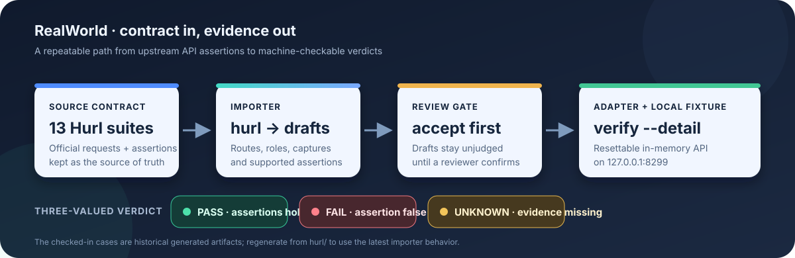
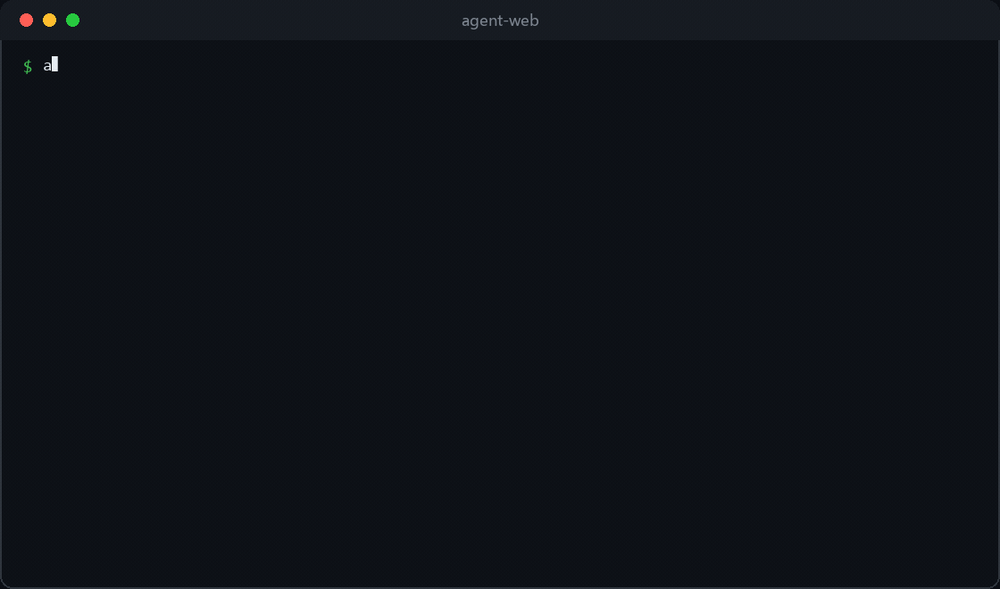

# RealWorld 语料：13 个套件转成案例

`realworld-apps/realworld`（原 `gothinkster/realworld`）提供一份 API 契约和多种实现。
`specs/api/` 里除了 `openapi.yml`，还有两套能直接跑的断言套件：`hurl/`（13 个文件）和 `bruno/`。
本目录包含 Hurl 套件副本、零依赖夹具，以及用于复核 importer 的流程图、终端动图和介绍视频。

<p align="center">
  
</p>

<p align="center">
  
</p>

[播放 52 秒介绍视频](../../docs/media/promo.mp4)

```
openapi.yml              19 个端点的契约（留给 discover 用）
hurl/*.hurl              13 个套件：157 步、296 条断言
fake-server.mjs          零依赖的内存实现，19 个端点，跑在 8299
```

## 怎么跑

```bash
# 1. 起夹具（--allow-reset 打开 /_fixture/reset，重复跑同一批案例必须开）
node examples/realworld/fake-server.mjs 8299 --allow-reset &

# 2. 把套件转成案例（--as 是「谁在操作」，默认 user）
node bin/agent-web.mjs import hurl examples/realworld/hurl --out=cases/realworld --as=user

# 3. 确认（草稿不出判决）
for f in cases/realworld/*.json; do node bin/agent-web.mjs accept "$f" --by=你的名字; done

# 4. 出判决
node bin/agent-web.mjs verify cases/realworld --adapter=realworld --detail
```

## 当前状态（2026-11-06，v0.46.0）

**13 条案例全绿：pass 13 / fail 0 / unknown 0，与预期标签一致 100.0%（13/13）。**

这一组是**派生文件**：断言逐条来自官方 hurl 原文，不许手改。全绿的含义是
「转换器 + 适配器 + 夹具三者自洽」，不是「某个 RealWorld 实现是对的」——
要验真实实现，把 `REALWORLD_BASE_URL` 指向目标服务再跑同一条命令。

修复过程中转绿的两个根因（都记在 `docs/museum/`）：

- **能力名推导丢了参数**：`PUT /api/articles/some-slug` 里 `some-slug` 是**字面量 slug**，
  早期实现把它当成资源名的一部分，推出 `some-slug.update` 这种不存在的能力。
  现在按路由位置识别（`articles/` 第二段一定是 slug），与 `{{slug}}` 走同一条路。
- **token 变量名不等于身份**：`updated_token` 是同一个人换了张票，早期实现把它当第二个人，
  于是「改自己的资料」被判成越权。

## 仍留在历史案例产物中的差异

| 案例 | 当前判决 | 原因 |
|---|---|---|
| `errors_articles` | `unknown/coverage_gap` | 旧 JSON 将静态路径段 `some-slug` 写成能力 `some-slug.update`；需要从 Hurl 重新导入再审核 |
| `favorites` | `fail/assertion_false` | 旧 JSON 把 DELETE unfavorite 留成 `articles.favorite` |
| `profiles` | `fail/assertion_false` | 旧 JSON 把 DELETE unfollow 留成 `profiles.follow` |

其余旧失败项对应的夹具/适配器问题已修：注册字段校验、tagList 更新、未认证错误体、评论越权文案与文章存在性、feed 分页和 token 身份继承。历史案例文件未被覆盖。

## 这个目录证明了什么

一份第三方套件，**不写代码**就能变成 13 条案例、157 步、296 条断言，判决由我们自己的三值引擎给出。
红的部分不是「工具不行」，是「夹具还没长成契约的样子」——而这恰好是这套工具存在的理由：
它把「实现与契约的差距」变成可数的数字，而不是一句「应该差不多」。
